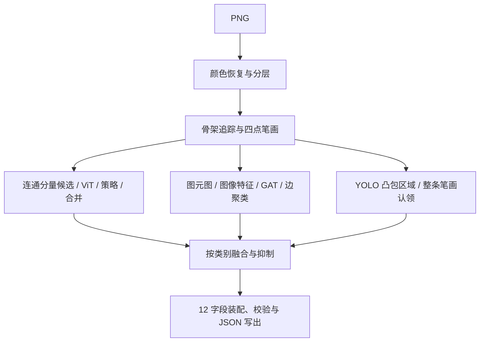

# 图纸分析赛道优化方案：从实例归属、几何一致性到可复现评测

> 编写日期：2026-11-22。审查基线：`6c228313d53fa55e587301bc92f07abc7d8359dd`。
> 本次交付仅新增本文，不修改代码、权重、依赖、既有文档或运行配置。
> 本文中的“已确认”来自源码或本次检查；“历史记录”来自仓库文档；“待验证”是后续实验假设。仓库没有竞赛数据、原始预测和完整实验日志，本次没有重新测得真实图纸 PQ，也没有进行训练。

## 1. 建议先做什么

优先顺序是：**恢复可靠运行与可信评测 → 修正训练、推理表示差异 → 定位实例损失 → 比较新的实例归属路线**。暂不优先换更大的分类器、继续堆融合分支或扩大模板库。

建议的新主线是：**直接从 PNG 预测实例位置及其所属笔画，在实例内部恢复精确几何，最后导出比赛格式**。现有图元 GAT 作为竞争路线，现有 hybrid 作为冻结对照。先以固定 YOLO 预测、只替换笔画分配方式的小实验验证方向，再决定是否训练新的实例模型。

JSON 是提交协议，不是识别算法。内部可以使用张量、实例掩码、局部线段图、点集或参数化曲线；没有必要让模型直接生成 JSON，也不必让全部处理围绕 JSON 展开。依照当前 README，最后仍须输出规定的 12 字段 JSON。更换最终文件格式是否允许，要以主办方原始规则为准。

当前最具体的三个抓手是：

1. **训练输入不一致**：同一个弯折候选，训练样本只保留两个端点，推理保留四点；本次受控检查已重现掩码差异。
2. **区域检测与细线归属不一致**：YOLO 学习填充凸包，评分却要求准确的实例细线；当前通过整条笔画认领把两者连接起来。
3. **运行包不完整**：本次 `infer.py --check-only` 因缺少 `ultralytics` 失败；默认路径还依赖未列入 `requirements.txt` 的 `torchvision` 和包外 ResNet 预训练权重。

这些问题值得优先处理，但尚不能宣称它们各自解释了多少真实分数。

## 2. 赛题要求和证据边界

### 2.1 当前可以确定的接口

依据 [README](README.md)、[提交说明](提交说明.txt)、[配置常量](cadvec/config.py) 和 [输出校验](cadvec/schema.py)：

| 项目 | 当前仓库要求 |
|---|---|
| 推理输入 | PNG；正式 `dev_final` 路径不读取 SVG 或标签 |
| 训练监督 | 使用允许的训练数据及同名带语义、实例标注的 SVG |
| 输出文件 | 每张 PNG 对应同名 JSON，不能缺文件或重名覆盖 |
| 几何字段 | `commands`、`args`、`lengths`，四种图元，每个图元四个二维采样点 |
| 语义与实例 | `semanticIds`、`instanceIds`；0–29 为 Thing，30–34 为 Stuff，35 为忽略 |
| 其余字段 | `width`、`height`、`obj_cts`、`boxes`、`rgb`、`layerIds`、`widths` |
| 长度关系 | 图元数组有 N 项；`obj_cts`、`boxes` 是 Thing 对象级数组，不能误解为所有字段都必须 N 项 |
| 运行约束 | 仓库声明为 64 位 Linux、离线运行、模型参数总量不超过 5B |

`width`、`height` 默认 100×100，是输出坐标系，不是 PNG 的像素尺寸。任何裁剪、缩放、分块都必须明确映射回统一画布。

### 2.2 尚未取得的原始材料

本仓库 README 已是项目提交说明，未包含独立的主办方原始评分器、完整赛事规则和 FAQ。因此“本地实现等价于官方”“允许哪些外部数据、预训练权重”“具体时间、显存、压缩包限制”等，需要在实施开始时和原始材料核对。本文不会把仓库推断写成主办方确认。

既有 `RESEARCH_PLAN.md` 根据类别与标注形式推断数据关联 FloorPlanCAD；这可以作为研究线索，不能据此确认数据来源、推断允许扩充外部训练集，或对公开标注进行答案反查。默认方案只使用赛事允许的训练数据。若后续规则允许外部数据或预训练，再独立检查来源、授权、重复图纸与数据划分。

## 3. 当前程序实际上怎样运行

### 3.1 入口与默认流程

实际入口为仓库根目录的 [infer.py](infer.py)，`run.sh` 最后也是执行它。`infer.py:100` 的默认引擎是 `hybrid`，不是部分帮助文本、README 段落和提交说明仍写的 `v2`；默认线程数是 1。文档中的“v3”不是一个可选 engine，而是 `pipeline_v2` 配合策略、去重和数量限制形成的配置。



默认执行路径的细节：

| 阶段 | 实际行为 | 源码位置 |
|---|---|---|
| 启动 | 设置线程环境、安装离线防护、审计权重；`--check-only` 到此退出 | `infer.py:458–482` |
| 输入枚举 | 递归发现 PNG，检查同名 stem，支持分片 | `infer.py:268–282`、`:488–513` |
| 场景恢复 | 原图 RGBA → 调色板颜色层 → 骨架 → 膨胀 2 像素分量 → 路径四点采样；所得笔画统一 `command=0` | `cadvec/dataset.py:54–126` |
| ViT 分支 | 候选总长至少 1.2，保留最长 240 个，四通道裁剪分类；融合颜色先验、类别策略与 NMS；再合并和截断 Thing | `cadvec/pipeline_v2.py:260–395` |
| GAT 分支 | 最多取最长 1200 条笔画；14 维几何加 256 维 ResNet 图像特征；语义、边概率预测后并查集聚类 | `cadvec/pipeline_gat.py:89–213` |
| YOLO 分支 | `imgsz=640`，预测区域后按四个笔画采样点的落入比例认领整条笔画，按检测置信度先到先得 | `cadvec/pipeline_segdet.py:113–161` |
| 默认融合 | ViT 管线为底；GAT 的 class 8 做并集去重；YOLO 接管 `{26,29,15,23,16,10,12}`；最终抑制 `{2,11,14,17,18,21,22,30,34}` | `infer.py:570–607`、`cadvec/hybrid.py:119` 起的 `merge_final` |
| 输出 | 重编号、组装、校验、写出；逐图异常默认写空 JSON；除非 `--strict-exit`，逐图失败仍可返回 0 | `cadvec/schema.py`、`infer.py:682–756` |

hybrid 中 ViT 分支的 Thing 上限为 12、GAT 为 8、YOLO 为 10，**最终融合结果并非统一最多 12 个实例**。YOLO 权重缺失时 hybrid 会跳过此分支，导致同名配置的实际能力变化。

`component_scene` 在同一线程缓存最近一张图，减少三个分支重复提取几何。它使用原图尺寸；帮助中的 `--max-detection-size`、`--min-primitive-length`、`--instance-gap` 等不能想当然视为在默认所有分支生效。hybrid 的 YOLO 门限和数量、GAT 数量等还存在内部固定值；例如 `--inside-fraction` 的独立 segdet 参数不会覆盖 hybrid 中固定的 0.35。后续实验必须记录实际生效配置，而非只保存命令行。

### 3.2 当前训练链路

| 路线 | 数据准备与训练 | 当前监督的含义 |
|---|---|---|
| ViT | `build_palette.py` → `build_candidates.py` → `train_vit.py` | GT 裁剪与恢复候选混合；候选按 IoU/覆盖率标为类别或忽略 |
| GAT | `build_primitive_dataset.py` → 可选 `build_node_features.py` → `train_gat.py` | 笔画节点的语义及边的同实例标签 |
| YOLO-seg | `build_yolo_seg_dataset.py` 生成数据，再用 Ultralytics 训练 | GT 实例采样点的填充凸包，不是精确笔画掩码 |
| dense segmentation | `build_seg_labels.py` → `train_unet.py` → `pipeline_seg.py` | 像素语义，实例仍依赖后处理；这不是完整的查询式实例分割 |

`det`、`tpl`、`seg` 等备选引擎有代码，但其默认所需的检测器、模板库、U-Net 权重不在当前 `weights/` 中，不能描述成全部可直接切换运行。

### 3.3 后续复现基线的命令

以下是**补齐环境、取得合法本地数据后**使用的现有命令，不表示本次已经成功完成数据推理。命令按 Linux shell 展示，路径可替换；从仓库根目录运行，无须再 `cd submission`。

```bash
python infer.py --check-only

python infer.py --input ../datasets/test_final --output _work/baseline_pred \
  --engine hybrid --weights weights --workers 1 --strict-exit \
  --summary _work/baseline_summary.json

python tools/svg_to_json.py --svg-dir ../datasets/test_final \
  --out _work/gt_json --skip-validation

python -m cadvec.evaluate --gt-dir _work/gt_json \
  --pred-dir _work/baseline_pred --raster-size 1000 --dilate 0 \
  --json-out _work/baseline_eval.json
```

这里的 `test_final` 是仓库称呼的本地带标签评估数据，能否用于校准必须核对赛事规定。`--skip-validation` **只用于 GT 导出**：GT 可能有 Thing 且实例号 -1，评估会跳过，但提交格式校验会拒绝；预测结果仍必须严格校验。需要同时检查摘要 `errors=0`、输出覆盖、非空预测和各分支加载成功，不能只检查文件数量或退出码。

## 4. 2.597% 告诉了我们什么

### 4.1 先区分本地指标与官方成绩

README 和 `validation.json` 记录的是本地 `test_final` 1000 张：

| 指标 | 历史记录 |
|---|---:|
| PQ | 2.597% |
| SQ | 62.647% |
| RQ | 4.145% |
| TP / FP / FN | 244 / 4201 / 7085 |

据此计算，计分段预测数为 4445，GT 段数为 7329，precision 约 5.49%，recall 约 3.33%。这些“段”同时包括 Thing 实例和按类别聚合的 Stuff，不应全部当作独立物体。

本地定义见 `cadvec/evaluate.py:106–112`：

```text
PQ = Σ匹配 IoU / [TP + 0.5 × FP + 0.5 × FN]
SQ = Σ匹配 IoU / TP
RQ = TP / [TP + 0.5 × FP + 0.5 × FN]
PQ = SQ × RQ
```

可以确定：成功匹配的比例很低。不能由 SQ≈63% 推出“几何已经足够好”，因为 SQ 只看成功匹配的少数预测。未匹配可能来自类别、边界、位置、拆分、粘连、漏线、额外线或空输出，必须进一步拆解。

还可以做一个算术检查：假设保留同样 244 个 TP、同样 FN 和匹配 IoU，只完美删除全部 FP，PQ 也仅约 **4.04%**。这不是新算法上限，却说明继续只做 FP 抑制不可能实现数量级提升；必须把更多真实实例变成 TP。

### 4.2 本地评分器的真实行为

`cadvec/evaluate.py:62–103`、`:135–178`、`:192–272` 的实现为：

- 仅使用 `semanticIds`、`instanceIds`、`commands`、`args` 生成计分掩码；其他字段仍须满足提交契约。
- 类别 35 跳过；Thing 且实例 -1 跳过；Stuff 按类合并。
- 默认栅格 1000×1000；Line、Arc 都按四点折线画 **1 像素线**；Circle、Ellipse 根据四点的外接框画椭圆。
- 同类别、IoU **严格大于** 0.5 才进入匹配；使用匈牙利匹配。
- 同时提供累计 micro 和类别平均 macro，必须核实官方采用哪一个。
- 目录评估默认取 GT 的画布尺寸同时解释预测，不核对预测声明的画布是否一致。

因此，不能靠调 `widths` 加粗输出获得本地 IoU 提升；也不能把 `--dilate` 的诊断提升当作正式成绩。更要区分两种几何：PNG 可见的原始曲线，与 GT 经四点采样后评分器实际绘制的几何。对长弧来说，更贴近 PNG 的曲线并不自动更贴近被评分的四点折线。应同时做图像重建与评分表示对齐，先核准官方规则再选择输出编码。

## 5. 源码审查发现：哪些已确认，哪些仍需测量

### 5.1 已确认的实现问题或不一致

| 优先级 | 证据 | 为什么应处理 | 后续验证 |
|---|---|---|---|
| P0 | `requirements.txt` 无 `ultralytics`、`torchvision`；默认分支分别导入它们 | 干净环境无法按声明依赖完整运行；本次权重审计已因前者失败 | 空缓存、断网容器完整跑正式入口 |
| P0 | `cadvec/image_features.py:24–29` 用 ImageNet ResNet18 权重，manifest 没有列入 | 依赖机器缓存；首次加载可能尝试下载，且运行模型清单不完整 | 显式本地权重、来源和哈希，审计所有实际加载模型 |
| P0 | `cadvec/pipeline_segdet.py:113–114` 写死 `device=0` | 与自动 CPU 回退描述不符 | 分别跑 CPU、GPU；或按真实交付要求明确只支持哪种设备 |
| P0 | `cadvec/dataset.py:367–383` 训练候选的 Line 仅保存 `p0,p1`，而 `cadvec/pipeline_v2.py:158–173` 推理保留四点 | 同一对象的第四通道形状在训练、推理时不同 | 共用编码器；逐候选验证裁剪一致，再做受控重训 |
| P1 | `tools/train_gat.py:233–248` 的 OneCycleLR 按每轮图数配置，却每轮仅调用一次 scheduler；优化器每图更新 | 实际学习率曲线不等于所配置的更新计划 | 记录每次优化更新的 LR，再比较相同预算训练 |
| P1 | `tools/build_candidates.py:50–53` 最长 120 候选，推理 `cadvec/pipeline_v2.py:283–287` 最长 240 | 训练采样范围与推理范围不同 | 分别统计后 120 候选的标签、误检、漏检贡献 |
| P1 | ViT 以分类指标选权重，GAT 以边 F1、前景准确率选权重 | 优秀局部指标不保证最终实例能匹配 | 增加完整验证图 PQ 选择，并保留局部指标定位问题 |
| P1 | 默认异常处理写空结果，逐图异常不一定造成非零退出码 | “有 JSON、命令成功”不能证明预测有效 | 运行失败数、空预测率、分支加载与逐图耗时一并验收 |

当前 manifest 声明 6,666,931 个参数，覆盖 ViT、YOLO-seg、GAT。本次以 `weights=None` 创建同结构的 ResNet18 layer3 特征主干，计得另有 **2,782,784** 个参数；两者合计约 9.45M，仍远低于 5B，但清单与离线资源需要补齐。此处没有下载预训练权重，也未把未声明主干自动加入现有配置。

### 5.2 高价值假设，需要数据决定影响大小

1. **早期几何可能设定了低上限。** 颜色层至少 40 像素、骨架/分量大小、路径长度、四点压缩等均会筛除或改变线；GAT 又只保最长 1200 笔画。要统计它们删除了多少 GT 墨迹和小实例，不能直接全部放开。
2. **规则分组可能粘连或碎裂。** `cadvec/pipeline_v2.py:182–210` 仅用 bbox gap≤0.8 做并查集合并；GAT 也做边阈值后的传递闭包。少量错误连接可能扩散，但真实发生率未知。
3. **粗掩码不等于准确笔画归属。** 凸包包含墙线、文字和其他对象；`cadvec/pipeline_segdet.py:130–158` 将笔画整体分给先认领的检测，不能局部切开跨实例笔画。
4. **标签栅格与评分栅格不同。** 候选监督使用 400px OpenCV，图元监督使用 300px OpenCV，评分使用 1000px PIL。取整、曲线、细线碰撞可能制造标签噪声；先比较相同几何的掩码与标签翻转率。
5. **SVG 导入能力有限。** `cadvec/svg.py:408–459` 主要解析 path/circle/ellipse，未处理 transform、组样式继承；多子路径沿总长度取四点；`parse_viewbox` 返回宽高，不处理非零原点。先统计真实数据是否使用这些特性，并与官方转换规则比较，再决定是否修订。
6. **颜色先验可能过度依赖图纸风格。** 已有记录表明更大先验权重未必更好；应按图纸来源分组验证，比较颜色扰动、灰度和弱化先验。
7. **去重与限制可能误删真阳性。** `cadvec/pipeline_v2.py:412–425` 用坐标保留一位小数作为去重键，相当于 1000px 下约 1px 的区分粒度；它没有量化实际输出坐标，但可能把不同细线当重复。NMS 在 160px 上进行，top-K 和永久抑制类别也可能伤害密集或长尾图纸。
8. **数据加载和增强值得单独审计。** ViT 流式数据每 worker 先随机打乱再分片，可能重复或漏采；GAT 翻转、抖动几何但沿用缓存图像特征，基础边特征也未完整同步重算。应逐通道核对不变性并实际记录样本覆盖，不能只看“有数据增强”。

以上均须通过叠图、计数和消融量化。尤其不能在没有证据时把“标注歧义”视作已证明的不可突破上限。

## 6. 从已有实验吸取什么

以下是仓库历史记录，未在本次重跑；跨不同子集的数值不直接作公平比较。

| 已试路线 | 历史结果 | 本次对结果的解释 |
|---|---|---|
| v1 几何加颜色分类 | 全量 PQ=0 | 单纯保证合法格式和恢复线条远远不够 |
| v2 骨架候选加 ViT | PQ=1.575% | 修复颜色、增加分类仍未解决完整实例 |
| v3 规则抑制、NMS、数量限制 | PQ=1.884% | 削减 FP 有收益，但不是突破实例召回的证据 |
| GAT v2 | PQ=1.627% | 已实现；不能再次把“首次引入 GAT”当新方案 |
| YOLO-seg 加笔画投影 | 区域 Mask mAP50=0.738；最终 PQ=1.673% | 两个指标评估对象不同；需测区域到笔画的损失 |
| 三分支 hybrid | PQ=2.597% | 保留为对照，不继续无依据地加模型 |
| 前 60 图替换正确类别 | PQ=3.164% | 仅在该候选、该子集与该 oracle 下，纠正类别不能补齐实例 |
| GT 辅助笔画归属 | 历史召回 59.7% | 是特定 oracle 的召回，不是可实现 PQ，也不是全任务上限 |
| 模板拟合 | GT 位姿命中约 62.2%；GT 框和类别下约 2.3% | 当前瓶颈是对应关系与位姿恢复；模板库扩容暂缓 |

主要证据见 [OPTIMIZATION.md](OPTIMIZATION.md) 第 7、8、10、12 节，以及 [validation.json](validation.json)。calib/holdout 各 500 张只是历史切分；不能据此确认最终 holdout 从未参与选类、门限或模型路线选择。

对既有研究文档，应调整三项判断：

- SVG 输入论文的高 PQ 不能直接换算成本项目 PNG 输入的得分，也没有可靠的统一折扣系数。
- 一个小 U-Net 或凸包分割实验失败，不能证明所有像素实例方法存在 10–20 PQ 的上限。
- 公共数据集与本赛题相似，不代表外部数据、预训练或公开 test 标注可以使用。只有正式规则能决定可用范围。

## 7. 第一阶段：先建立能定位损失的诊断矩阵

先冻结基线权重和代码，使用合法本地带标签数据。额外使用 GT 的实验只作离线诊断，不进入正式推理。

### 7.1 统一评测与坐标

| 编号 | 实验 | 产物与判定 |
|---|---|---|
| E0 | GT 经过序列化、读取后作为自身预测 | 有有效段时 PQ/SQ/RQ 应为 100%；记录有效、忽略段数。这只验证内部闭环，不能代替官方一致性验证 |
| E1 | 用线、弧、圆、椭圆、Stuff、多实例、忽略类和恰好 IoU=0.5 的样例，对比官方与本地输出 | 明确四点含义、取整、严格阈值、画布、micro/macro；保存掩码差分 |
| E2 | 对固定预测做 ±0.25/0.5/1 像素平移、轻微缩放，以及 `dilate=0/1/2` 诊断 | 绘制敏感性曲线；最终比较始终用正式口径，不能按单图 GT 选择平移 |
| E3 | 从 PNG、SVG 到裁剪、YOLO、画布、JSON 的全部变换叠图 | 覆盖非方图、非100画布、非零 viewBox、不同分辨率；坐标错位是否存在由结果判定 |

注意：现有 `component_scene` 不缩放原图；不能仅凭 YOLO 使用 640 输入就宣称 `masks.xy` 错位。要核对接口返回的原图坐标和实际传入图像。

### 7.2 分别测几何、候选、类别和实例归属

| 编号 | 固定什么、替换什么 | 要回答的问题 |
|---|---|---|
| E4 | 逐步比较完整追踪路径、四点表示、导出后的评分掩码 | 几何损失发生在骨架、采样、命令编码还是导出？ |
| E5 | 候选几何不变，提供最有利 GT 类别与实例归属 | 现有不可拆候选能支持多少匹配？不得偷偷裁剪、补线 |
| E6 | 分别只替换类别、分组、GT 区域、笔画归属 | 哪一环节造成最大 TP 损失？分别报告 TP/FP/FN、PQ/SQ/RQ |
| E7 | 用 GT 凸包和 GT 精确墨迹分别替换 YOLO 区域，沿用当前整条认领 | 完美区域是否仍被笔画认领或几何编码拖垮？ |
| E8 | 固定同一 YOLO 预测，比较整条认领、密集采样、局部切分、归属 oracle | 最小改造能否证明“延后矢量化”值得做？ |
| E9 | 单独消融 bbox 合并、类别抑制、颜色先验、NMS、top-K、长度/数量限制 | 哪些规则真正有效？不得把 ViT 的 top12 当整个 hybrid 上限 |
| E10 | 每个分支单独输出，再逐个融合 | 记录新增 TP、FP、丢失 TP、冲突与耗时，识别有害接管 |

每个实验同时提供每类、目标尺寸、墨迹长度、密集程度、图纸来源的分解，以及 GT/预测叠图。给未匹配段分配可复核的原因标签：空输出、无候选、错类、定位偏差、碎裂、粘连、额外笔画、漏笔画、重复预测；允许多原因，不强行一因归类。

**阶段出口：**取得可追溯的评分闭环、运行基线和至少一份实例损失报告，确定后续主攻几何、归属还是分类。没有这些结果，不开始大模型扩容。

## 8. 推荐主线：图像实例与笔画归属优先，矢量化后置

### 8.1 先做低成本桥接实验 A0

复用已有 YOLO 权重、预测类别和区域，暂不重训：

1. 保留原图 RGBA、完整追踪路径和坐标变换，不在实例归属前只剩四个点。
2. 在重叠候选区域内，为局部墨迹或短线段保留多个实例归属分数，替代“先到先得”。
3. 在掩码边界、交叉点、颜色变化处允许切分长笔画；对不同区域内的笔画片段分别判断。
4. 结合区域置信度、局部形状、距离与方向确定归属；未获可靠支持的墨迹保留为背景或忽略，避免整框收进墙线。
5. 在每个实例内部恢复中心线和四点评分表示，使用同一导出器评分。

这一步只检验区域到笔画的桥接。如果没有收益，先分析是否是区域监督、几何评分或类别本身不够，再决定是否投入新模型。

### 8.2 训练真正面向“实例墨迹”的模型 A1

构建两种监督，而不是继续只训练一个填充凸包：

- **实例区域监督**用于定位和召回；可沿用框、凸包等宽松表示。
- **实例墨迹监督**由合法 SVG 标注按核准的评分表示渲染，表示每个实例真正包含哪些线；与 PNG 叠加检查配准。

推荐从“小型全图定位网络 + 原分辨率 ROI 归属细化头”开始。全图分支看上下文，ROI 分支看细笔画；已有 YOLO 可先提供位置。输入可为 RGB/灰度、alpha 或墨迹置信度；alpha 不存在时明确采用对应前景提取。输出包含类别、区域、实例墨迹概率和质量分数。

若 ROI 路线被密集、断裂实例限制，再比较 Mask2Former 风格查询头：查询预测实例与所属墨迹，允许长距离不连通笔画属于同一对象。直接生成的低分辨率粗掩码不够，需保留高分辨率特征或局部细化头，不能简单放大 1/4 或 1/8 掩码后期待 1px IoU 合格。

训练设计：

- 类别损失，加实例墨迹的 BCE/Dice、边界/中心线损失，以及可选区域辅助损失；先逐项消融，再决定权重。
- 对细线进行前景与边界采样，避免白色背景主导损失；几何容差损失只用于帮助训练，最终成绩仍用严格评分。
- 区分“确实无标注的干扰线”与“标注存在但当前匹配失败”；不把所有几何失配直接变成强负样本。
- GT 如果在栅格上允许不同实例重叠，保留各实例独立掩码及交叉点信息，不能先压成单标签像素图而丢失归属。
- 同时训练空图、文字、尺寸线、表格线等真实难负例；是否需要单独 OCR 由 FP 样本决定。文字区域过滤应可撤回，避免删除附近门窗细线。
- 对旋转、镜像、缩放、颜色与 alpha/抗锯齿变化，同步变换图像、几何、mask 与边特征；增强范围由真实数据统计决定。

### 8.3 Thing 与 Stuff 分开处理

Thing 用实例查询、ROI 归属或实例嵌入；Stuff 用语义墨迹头，每类汇总为一个段。避免让墙体等长结构和小家具竞争同样的 top-K 实例名额。

目前 class 30、34 被最终抑制，class 33 还可能被分支策略抑制。恢复这些类应以专门的验证证据为条件，不能简单清空抑制表。尤其本地采用累计 micro 时，Stuff 每类每图的计分权重不能直接类比其像素面积。

### 8.4 在 6GB 显存预算下怎么落地

以 `environment.json` 记录的 RTX 3060 Laptop 6GB 为预算参考，实际训练前重新测量：

- 首先尝试 256–512 的 ROI 或带上下文的重叠块、小 batch、混合精度和梯度累积；这是试验起点，不是已验证配置。“原分辨率”指从原图取得有效细节：超出输入范围时比较分块与多尺度方案，明确是否缩放，并回原坐标细化，避免缩放后细线消失。
- 缓存图像特征和标签，避免每个候选重复解码整图；区分训练缓存与必须打包的推理权重。
- 分块必须保留全图坐标与上下文，独立验证跨块实例合并和边界召回。
- 查询数量由训练集实例数分布确定并留余量，避免复制固定 top12 的召回上限。
- 显存、吞吐先在 50–100 张代表图上实测，再估算全训练时间；不承诺几小时即可完成。

## 9. 竞争路线：修正后的图元图与实例查询

若 E4–E6 显示几何保留充分、主要损失在分组，则继续图路线有价值。但应改变现有约束，而非原样加深 GAT：

1. **节点更细且可拆。** 保留完整路径，在交点、曲率变化、区域边界切成局部图元；允许在后续归属时再合并。
2. **图要覆盖真实实例关系。** 同时考虑端点、共线、平行、颜色、相对方向、多尺度近邻与图像上下文；先测 GT 同实例的图连通覆盖率。
3. **减少错误边的传播。** 对边进行一致性、互惠性和冲突约束，比较带约束聚类与查询式图元掩码，避免一条假阳性边无条件合并整个链。
4. **处理节点数量限制。** 比较滑窗/分块图、稀疏注意力与多尺度图，报告截断导致的 GT 墨迹损失，不只按长度取前 1200。
5. **先修监督与训练。** 按正确几何绘制 Circle/Ellipse，必要时先合并 GT 实例再生成节点归属；检查 `class*1000+instance` 是否有碰撞；统一增强和 LR 调度。

先用现有 GAT 做预算一致的受控实验，再考虑 SymPoint 风格点/图元 token 加实例查询头。已有 GAT 的局部指标不能直接代表端到端实力，必须使用共同的最终导出和 PQ。

图路线和图像归属路线可以共享图像特征及最终几何拟合；只有分别验证出互补收益，才再次融合。默认优先开发 A0/A1，不同时铺开多个大模型。

## 10. 几何优化：同时贴近原图和实际评分表示

无论使用哪种识别模型，几何输出都是共同模块：

- **亚像素中心线。** 在原始 alpha、灰度或覆盖率上拟合中心线，明确像素中心、像素角点约定；比较当前 `+0.5` 采样与评分器的取整行为。不要只凭“更平滑”决定保留。
- **自适应切段与采样。** 内部保留足够多的路径点，在确定实例后按曲率和评分误差选择切段；每段最终输出规定四点。确认规则允许多个合法图元表达同一实例，并防止图元数无控制增长。
- **直线、圆、弧、椭圆按需恢复。** 复用现有 `strokes.py` 的拟合能力作对照，但弧的输出必须尊重评分器对四点的解释，不为了几何类型丰富而降低评分 IoU。
- **方向和端点约束只在有支持时使用。** 平行/正交先验可以提高规则结构的稳定性，但不得把相邻对象强行合并，也不能让全局吸附破坏真实斜线。
- **可选的局部重投影优化。** 用可微渲染或距离场在固定实例内精修坐标；设置图像支持、拓扑与复杂度约束。它只能作为独立消融，不能替代实例归属。
- **共享渲染与导出。** 训练监督、候选质量目标、NMS、最终输出应明确使用什么栅格器、尺度和曲线规则；测试掩码差异，不必强求所有辅助操作都耗用 1000px。

几何验收同时看严格 IoU、中心线距离、端点误差、实例召回和生成图元数。调高分辨率或增加点数若只改善视觉效果、不改善正式评分，应继续检查 GT 的四点表示差异。

## 11. 数据与训练改良

### 11.1 固定数据角色，防止反复调到评估集

`weights/class_policy.json` 明确标注来源为 `test_final calib 500`。这证明它参与过校准，但不能仅凭名称判定是隐藏测试泄漏。需要追溯合法用途和样本清单。

建议在允许训练的数据中建立按来源分组的 train/validation/calibration；另保留从未参与选模型、选类别、选门限的最终本地评估集。按原始图纸、建筑项目或同源切片分组；来源缺失时用感知哈希和几何相似度辅助去重，再人工抽检。所有候选缓存、调色板、先验和模板库应记录由哪个划分构建。

冻结样本 ID、文件哈希、随机种子、变换、模型哈希和生效配置。历史 calib/holdout 的成绩作为参考，无法保证清洁的部分不继续当作最终泛化证据。

### 11.2 把标签质量变成可测量对象

- 对每类、尺寸、复杂度分层抽检 PNG/SVG 配准、实例边界、ignore 与未标注图元。
- 比较 300/400/1000px 标签匹配的稳定性；同时检查同一恢复笔画跨多个 GT 图元时的归属。
- 记录 GT 样本最多 48 个实例、每实例前64图元，候选前80笔画等截断造成的覆盖损失。
- YOLO 数据构建跳过没有有效实例的图纸，且按文件名末尾约 6% 验证；重新评估是否缺少真实空图和难负例，以及是否有来源偏差。
- 分开报告 GT 裁剪分类、恢复候选分类、候选召回、最终实例 PQ，避免干净 GT 裁剪成绩掩盖部署候选错误。

### 11.3 先检查能否学会，再加训练规模

先在一小组有代表性的训练图上过拟合，比较模型结果与同一表示的 oracle；如果训练样本本身无法接近可达结果，先排查监督、损失、坐标与解码。然后再比较修复输入编码、修复 LR、同步增强、难负例、类别采样的单项收益。

使用按实例或类别平衡的采样，谨慎加入长尾过采样与 focal loss；不得把颜色 ID 或文件名作为记忆答案的捷径。多 worker 实际消费的样本 ID 需要统计覆盖率和重复率。模型选择采用核准的官方端到端评分脚本及汇总口径；取得原始材料前，暂用完整验证图上的本地严格 PQ，并明确其暂定性质。分类、边 F1、mask mAP 作为诊断。

## 12. 路线选择、实施顺序与止损标准

下列人日是任务拆解估算，假设数据、原始规则和可用 GPU 已就绪；不是训练耗时或成绩保证。各阶段另提实现 PR，本 PR 不执行这些修改。

| 阶段 | 建议工作量 | 主要任务 | 交付与出口 |
|---|---:|---|---|
| P0 运行与评测 | 1–2 人日 | 依赖、全部权重清单、空缓存离线、设备选择、有效配置；核准评分与数据用途 | 正式入口能完整跑代表集；无逐图异常；官方/本地差异有记录 |
| P1 一致性与诊断 | 2–3 人日 | 统一两点/四点编码、核查训练调度/增强；执行 E0–E10 的核心项 | 得到损失分解及修复后基线；确定几何与候选上限 |
| P2 最小桥接 A0 | 1–3 人日 | 固定 YOLO 输出，局部笔画归属、切分、延后采样 | 同一数据、相同模型下验证桥接净收益，否则返回诊断 |
| P3 主线模型 A1 | 3–5 人日起 | 精确实例墨迹监督、ROI 细化、Thing/Stuff、难负例 | 在固定验证与校准流程下超过修复后的最佳基线 |
| P4 图路线对照 | 2–4 人日起 | 依据 oracle 决定是否做可拆节点、约束聚类或查询头 | 同预算对比；只保留有净收益或明确互补的模块 |
| P5 最终验证 | 1–2 人日 | 门限冻结、全量盲评、资源和断网容器检查 | 可复现实验表、失败样本、正式交付包；再取得官方成绩 |

共同的路线判断标准：

1. **只提高 mAP、分类准确率或视觉效果，不提高最终 PQ，不算路线通过。**
2. 先用代表集筛选，再在固定完整本地评估集确认；按图纸来源做配对重采样或 bootstrap，报告增益区间，避免把少量 TP 波动当突破。
3. 图像路线若在 GT 区域条件下仍因几何投影失败，先修几何和归属；图路线若节点 oracle 已很低，先修表示，不继续堆注意力层。
4. 模板仅保留在可可靠定位、变体有限且专项验证有效的符号上；当前全局模板路线继续暂停。
5. VLM/LLM 直接读整图输出海量坐标不作为主线。若正式允许，本地小模型可做少量疑难 ROI 的语义辅助，仍需受控实验、完整离线打包和参数审计。
6. 阶段成果以相对同一修复后基线的实测提升验收，不承诺达到 20%、50% 或任何论文数字。

建议后续实验记录模板：

| 实验 ID | 划分/权重/配置哈希 | 修改项 | TP/FP/FN | PQ/SQ/RQ | 每类与尺寸分解 | 空预测/失败数 | 秒/图、显存、内存 | 结论 |
|---|---|---|---|---|---|---|---|---|
| 待实施 | 待记录 | 每次仅改变可归因的项目 | 待测 | 待测 | 待测 | 待测 | 待测 | 待定 |

如果同一个模型修复多个相互依赖项，可先合并成正确基线，再做有意义的分组消融；不为追求表格完整而保留已知不正确实现。

## 13. 本次实际做过的验证

| 检查 | 本次结果 | 能证明什么、不能证明什么 |
|---|---|---|
| `python -B -m pytest tests -q -p no:cacheprovider` | **47 passed，11.63s** | 既有测试通过；不代表真实数据分数、默认 hybrid 或干净容器可用 |
| `python -B infer.py --check-only` | **失败：`ModuleNotFoundError: No module named 'ultralytics'`** | 当前环境无法反序列化 YOLO 权重完成审计；缺失依赖也确实未列入 requirements |
| 同一弯折候选走训练与推理裁剪编码 | 训练 2 点、推理 4 点；第四通道 mask IoU=**0.024523**，RGB 通道一致 | 已证实可造成输入差异；这是单个构造样例，不能当真实数据平均损失或涨分幅度 |
| ResNet18 特征主干参数计数 | `weights=None`，layer3 主干 **2,782,784** 参数 | 验证同结构额外参数量；没有下载或运行预训练主干 |
| 当前环境基本信息 | Python 3.13.9；torch 2.6.0+cu124；torchvision 0.21.0+cu124；CUDA 可用；ultralytics 不可导入 | 记录本次检查环境，不代表比赛容器环境 |
| 真实数据训练、全量 PQ、Docker 离线端到端 | **未执行** | 仓库不含竞赛数据；本次保持文档范围，不补装依赖、不修改代码 |

受控裁剪检查使用一条经过 `(10,10)→(10,30)→(30,30)→(30,50)` 的笔画，分别调用现有 `label_hypotheses` 的训练导出和 `_stroke_payload` 的推理导出，再调用同一个 `render_crop`。它用于验证明确的数据路径差异，没有生成新的训练数据或写入任何权重。

## 14. 查证资料与适用范围

以下只引用原始论文、作者项目页或官方实现。资料于 2026-11-22 查阅；本文不复述未经核实的“最新 SOTA 排名”。

| 来源 | 可以借鉴的机制 | 本项目适用边界 |
|---|---|---|
| [FloorPlanCAD，ICCV 2021](https://openaccess.thecvf.com/content/ICCV2021/html/Fan_FloorPlanCAD_A_Large-Scale_CAD_Drawing_Dataset_for_Panoptic_Symbol_Spotting_ICCV_2021_paper.html) | 结合图像与图结构识别 Thing/Stuff | 原始矢量输入任务；不能据此认定竞赛来源或许可 |
| [GAT-CADNet，CVPR 2022](https://openaccess.thecvf.com/content/CVPR2022/html/Zheng_GAT-CADNet_Graph_Attention_Network_for_Panoptic_Symbol_Spotting_in_CAD_CVPR_2022_paper.html) | 相对空间关系、边编码与实例子图 | 当前已有精简实现；应比较具体差异，而非再次宣布引入 GAT |
| [SymPoint / Symbol as Points，2024](https://arxiv.org/abs/2401.10556) | 图元点表示与实例掩码查询头 | 可作为图路线结构参考；SVG 图元上的论文指标不能当 PNG 得分预期 |
| [Mask2Former，CVPR 2022](https://arxiv.org/abs/2112.01527) | 用掩码分类统一实例、语义与全景任务 | 支持探索实例查询，不能保证细线几何精度或本赛题成绩 |
| [Deep Vectorization of Technical Drawings，ECCV 2020](https://www.ecva.net/papers/eccv_2020/papers_ECCV/html/1978_ECCV_2020_paper.php) | 图像清理、图元预测及几何精修的分阶段设计 | 可用于几何模块对照；其训练数据不自动属于本赛题允许范围 |
| [DiffVG，2020](https://people.csail.mit.edu/tzumao/diffvg/diffvg.pdf) | 对矢量几何连续参数进行可微渲染优化 | 可选局部坐标精修，不负责离散拓扑和实例识别 |
| [Torchvision ResNet18 官方文档](https://docs.pytorch.org/vision/stable/models/generated/torchvision.models.resnet18) | 明确权重选项、预训练来源与模型接口 | 实际部署应锁定与 torch 兼容的版本，并使用显式离线权重 |

研究方法的选择依据是本项目的损失分解与同口径实验。已有文献证明的是相应设置下的机制有效，PNG 到实例墨迹、再到四点评分几何的完整链路仍需本地验证。
