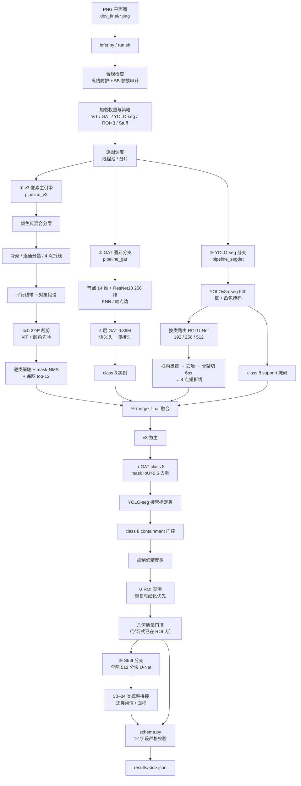

# CADshibie 当前程序架构

> 对应 2026-11-24 主线版本：test_final 全量 1000 张本地 PQ **23.896%**，
> 约 1.5 s/张，模型参数合计 23.08M，全程离线。
> 默认入口 `run.sh` → `infer.py --engine hybrid`。

## 1. 运行时总览（终端版）

```text
[输入] dev_final/*.png（透明底 + 抗锯齿细线，无 SVG）
  │
  ▼
[入口] infer.py / run.sh
  ├─ 合规：compliance/net_guard.py 进程级离线防护
  ├─ 审计：compliance/params.py（23.08M / 5B 上限）
  ├─ 加载：调色板、ViT、GAT、YOLO-seg、3×ROI U-Net、Stuff U-Net、策略 JSON
  └─ 调度：每图独立处理（--workers 线程池，或 --shard-count 多进程分片）
  │
  ▼
════════════════════ hybrid 三路分支（每张图）════════════════════

  ① v3 像素主引擎  cadvec/pipeline_v2.py        ── 提供大多数 Thing 实例
     PNG ─► 颜色反混合 + 颜色层                  (layers.py)
         ─► 骨架 / 连通分量 / 4 点折线           (skeleton.py)
         ─► 平行线带 + 端点对齐 + 轴向吸附       (parallel.py)
         ─► 对象假设                             (objects.py)
         ─► 4 通道 224² 裁剪                     (crops.py)
         ─► ViT 36 类 + 颜色先验(0.6)            (vit.py)
         ─► 逐类阈值/抑制 + mask-NMS(0.6) + 每图 top-12

  ② GAT 图元分支  cadvec/pipeline_gat.py        ── 只接管 class 8（盲窗）
     笔画节点（14 维几何 + 256 维 ResNet18 图像特征）
         + KNN/端点邻近边
         ─► 4 层 GAT（0.36M）─► 语义头 + 邻接头
         ─► 邻接概率阈值 + 同类并查集 ─► class 8 实例

  ③ YOLO-seg 分支  cadvec/pipeline_segdet.py    ── 完整实例候选 + 精确墨迹
     YOLOv8n-seg 640 ─► 检测框 + 实例凸包掩码
         ├─ class 8 support 掩码（只用于后面的门控）
         └─ 按类路由 ROI 墨迹 U-Net：
              class 2            → roi_ink_c2.pt   (192²)
              8,12,14,15,18,
              19,20,21,25,27,28  → roi_ink_256.pt  (256²)
              3,4,22,26,29       → roi_ink_512.pt  (512²)
              框内墨迹 ─► 8 连通去噪 ─► 骨架每 6px 切分 ─► 4 点短折线
              学习式质量门控（15 维特征 + 逐类逻辑回归）

════════════════════════════ 汇合 ════════════════════════════
  │
  ▼
  ④ merge_final  cadvec/hybrid.py：按固定顺序融合
     1. v3 像素管线为主
     2. ∪ GAT 的 class 8 实例（mask IoU > 0.5 去重）
     3. YOLO-seg 接管指定类  {3,4,10,12,15,16,23,26,29}
     4. class 8 containment 门控：实例须落在 YOLO 类 8 掩码内（>0.1）
     5. 抑制低精度类  {2,11,14,17,18,21,22,30,34,16,23}
     6. ∪ ROI 细化实例（mask IoU > 0.5 时用细化实例替换主引擎实例）
     7. 几何质量门控（roi_ink_quality.json：total/density/aspect/mean）
  │
  ▼
  ⑤ Stuff 分支  cadvec/stuff_branch.py
     全图 512 重叠分块 U-Net ─► 30–34 五类概率拼接
         ─► 逐类阈值 + 最小面积 ─► 4 点结构段（instance = -1）
         ─► 替换/追加 Stuff 输出，不触碰 Thing 实例
  │
  ▼
[cadvec/schema.py] 12 字段严格校验（长度、有限数、实例类别一致性）
  │
  ▼
[输出] results/<PNG 文件名>.json
```

## 2. 运行时总览（Mermaid 版）



## 3. 权重与类别路由

| 分支 | 权重 | 参数量 | 负责内容 |
|---|---|---:|---|
| v3 主引擎 | `vit_strokes.pt` | 2.91M | 全部 Thing 假设的 36 类语义 + objectness |
| GAT | `gat_primitive.pt` + `resnet18_layer3.pt` | 0.36M + 2.79M | class 8 图元级实例 |
| YOLO-seg | `yolo_seg.pt` | 3.40M | 接管 3,4,10,12,15,16,23,26,29；class 8 门控支持 |
| ROI-192 | `roi_ink_c2.pt` | 1.95M | class 2 墨迹细化 |
| ROI-256 | `roi_ink_256.pt` | 1.95M | 8,12,14,15,18,19,20,21,25,27,28 |
| ROI-512 | `roi_ink_512.pt` | 1.95M | 3,4,22,26,29 |
| Stuff | `stuff_unet.pt` | 1.93M | 30–34 五类 Stuff |
| 策略 | `class_policy.json`、`roi_quality_512c_all.json`、`roi_ink_quality.json`、`stuff_thresholds.json` | 0 | 逐类阈值、抑制、质量门控 |

> 提交包 `weights/manifest.json` 合计 23.08M（含 6 套 ROI 权重），
> 默认只加载 `roi_ink_c2.pt`、`roi_ink_256.pt`、`roi_ink_512.pt` 三套。

## 4. 训练 / 复现链路（离线，train_final 4000 张）

```text
train_final（PNG + 同名 SVG 真值）
  ├─ build_palette.py            → stroke_palette.json（197 色）
  ├─ build_candidates.py
  │    + train_vit.py            → vit_strokes.pt
  ├─ build_primitive_dataset.py
  │    + train_gat.py            → gat_primitive.pt
  ├─ build_yolo_seg_dataset.py
  │    + train_yolo_ab.py        → yolo_seg.pt
  ├─ build_roi_ink.py
  │    + train_roi_ink.py        → roi_ink_c2 / 256 / 512.pt
  ├─ build_stuff_tiles.py
  │    + train_stuff_unet.py     → stuff_unet.pt
  ├─ roi_quality_dataset.py
  │    + train_roi_quality.py    → roi_quality_512c_all.json
  ├─ calibrate_thresholds.py     → class_policy / 质量门控阈值
  └─ tools/evaluate.py           → validation.json（PQ / SQ / RQ）
```

## 5. 模块速查

| 层 | 文件 | 职责 |
|---|---|---|
| 入口 | `infer.py`、`run.sh` | 参数、合规、模型加载、并发调度、落盘 |
| 像素引擎 | `cadvec/pipeline_v2.py` | 单图 v3 全流程 |
| 几何 | `layers.py`、`skeleton.py`、`parallel.py`、`objects.py` | 颜色反混合、骨架、平行线、对象假设 |
| 语义 | `crops.py`、`vit.py`、`prior.py` | 裁剪、ViT 分类、颜色先验融合 |
| 图元引擎 | `pipeline_gat.py`、`primitive_graph.py`、`gat_model.py` | 图构建、GAT 推理、实例聚合 |
| 检测引擎 | `pipeline_segdet.py`、`segmodel.py` | YOLO-seg 推理、笔画认领、候选组装 |
| 墨迹细化 | `roi_ink.py` | ROI U-Net、矢量化、学习式质量门控 |
| 融合 | `hybrid.py` | 三路并集/接管/门控/抑制/去重 |
| Stuff | `stuff_branch.py`、`stuff_unet.py` | 全图分块语义、结构段输出 |
| 输出 | `schema.py` | 12 字段装配与严格校验 |
| 评测 | `cadvec/evaluate.py`、`tools/evaluate.py` | PQ / SQ / RQ（栅格 1000、IoU>0.5） |
| 合规 | `compliance/net_guard.py`、`params.py` | 离线防护、参数审计 |

## 6. 备注

- `infer.py --engine` 还保留 `segdet`、`det`、`tpl`、`gat`、`seg`、`v2`、`v1`
  等实验引擎；默认 `hybrid` 是当前最优组合。
- 稳定口径：所有门控与指标统一在 raster 1000、IoU>0.5 下计算。
- 已知限制：实例边界仍主要由几何连通性决定；文字/标注线是主要误检来源；
  GT 的 4 点采样会简化复杂符号。
