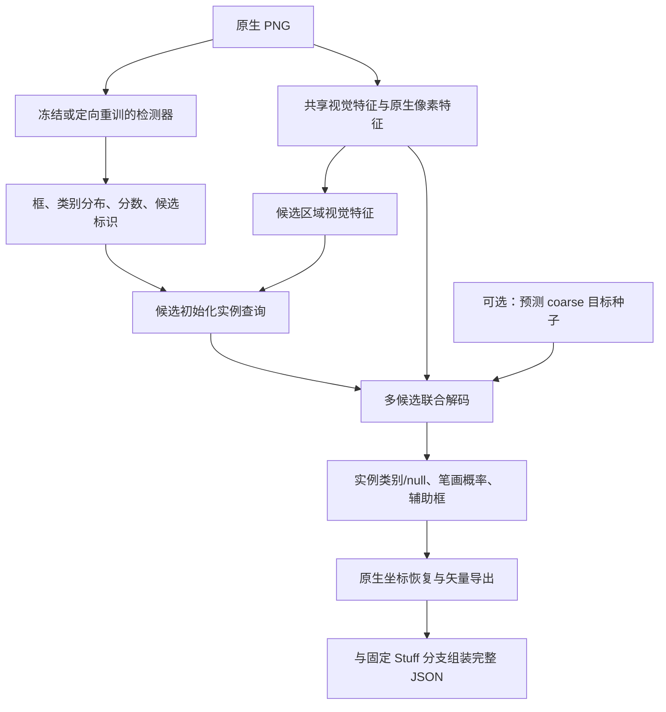

# 后续优化实施方案：从独立 ROI 修正转向候选联合归属

日期：2026-11-27。状态：**规划文档，未启动本方案中的训练或评分**。

用户已要求暂停实验。本次工作只整理路线、保护数据不进入 Git，并提交当前项目及文档；后续收到恢复指令后，按本文前置条件逐阶段执行。本文不触发训练、无标签 dev 批处理或官方成绩提交。

## 1. 目标、现状与本轮选择

目标是提高 CAD 任务的最终微平均 PQ，争取超过 50%，同时控制对已观察数据的过拟合。**50% 是目标，不是已经取得或能够保证的结果。**

当前可回退的默认版本是 `hybrid + native-residual-v2`：

| 项目 | 当前基线 |
|---|---|
| 历史同一 1000 页回归 PQ | **33.785%**；TP/FP/FN = 2852/2042/4477 |
| 当前原生细节头 | `weights/native_detail.pt`，484,303 个状态张量元素 |
| 原生细节头 SHA256 | `dd885ae635ac546a465c1622d1f99b64cec637494e78142888459b514bade907` |
| 检测器 | 35 个输出类别的 YOLOv8n-seg，3,399,033 参数 |
| 检测器 SHA256 | `1157d3014ad48fc376dee3fb9ce712f6df4a9798dcb7ea0c4d17e8cae395e1c5` |
| 新 dev | 809 张 PNG，无标签，不能报告本地 PQ |
| 本机 | Windows、Python3.13、RTX4060 Laptop 8GB；其他环境尚需单独验证 |

33.785% 是已观察历史数据的回归值，不是新 dev 或完全独立泛化成绩。第四、第五轮实验没有替换默认。详细历史见 [第三轮结果](ROUND3_RESULTS.json)、[第四轮记录](ROUND4_INSTANCE_OWNERSHIP.md)、[第五轮记录](ROUND5_QUERY_INSTANCES.md)。

**建议主线 B：检测候选初始化的联合实例归属。支持路线 D：针对漏检、错类、长尾定向重训检测器。** 两条路线分别固定对方，先明确各自收益，再考虑组合。类别条件、目标提示和位置引导属于主线 B 的组成部分；不再把每一个小模块单独包装成一轮完整架构升级。

## 2. 已做与未做，避免重复投入

| 方向 | 已做范围 | 下一步真正缺少的部分 |
|---|---|---|
| 目标实例提示 | 旧 coarse ROI 试过框中心/宽高；第四轮细节头联合加入类别和 dx/dy，固定 4 轮，所选 checkpoint 回到 epoch0 | 候选视觉特征、目标种子、邻居上下文，以及多个实例一起学习归属 |
| 重叠候选归属 | 整实例挂框、逐现有图元挂锚点；默认原子归属仅 class3/28 | 专门覆盖困难重叠的训练集、跨候选交互、实例一对一监督、共享笔画处理 |
| 定向重训检测器 | 历史普通训练与初始化 A/B 已做 | 按当前错误分布设计的类别平衡、难例与细线监督训练尚未做 |
| 新细节头类别信息 | v3 联合试过 class embedding＋dx/dy，没有进入默认 | 缺少 class-only、空间提示-only 的拆分对照，不能单独判定类别条件无效 |
| 整图自由 query | 已有轻量代码；只做过 8 个训练页、总 1000 次更新的能力检查，未学稳 | 尚未实现检测候选初始化，也没有成熟预训练查询模型的完整训练与验收 |

第五轮短试失败只说明当时原型未达到学习要求，不能否定全部查询式方法。反过来，模型能拟合少量训练页也不能证明会提高验证 PQ。

当前不优先继续：质量门限网格搜索、增加按类规则、继续相似变换模板替换、盲目延长自由 query 训练、未经接口验证就堆多个大模型。这些不是永远放弃，而是当前证据不足以支持优先投入。

## 3. 优先级依据：哪些损失需要模型改变

最新已观察的 155 页中，Thing GT 为 1221，TP 504、FN 717。FN 的框覆盖描述如下：

| 描述 | 数量 | 对路线的含义 |
|---|---:|---|
| 存在框 IoU≥0.5 的同类框 | 535 | 大量实例已有位置候选，单独增加检测召回不能解决全部损失 |
| 只有达到阈值的异类框 | 31 | 值得检查错类，但这不是完整分类错误因果统计 |
| 没有达到阈值的框 | 151 | 支持改进候选覆盖、尺度和检测训练 |

535 个实例中，336 个所属类别已有原生 ROI 路由，但当前候选均无严格匹配潜力；这不代表每个实例都实际经过了 native 网络。框覆盖还受置信度/NMS、相邻实例和一对一竞争影响，不能简单解释为检测器召回上限。

还有两个训练侧问题：

- `tools/build_native_detail.py` 会跳过部分歧义/部分重叠检测框，每类检测框最多 4 个、训练 GT supplement 只取每类前 2 个。原训练集合没有专门为困难归属设计。
- 旧检测数据构建器用实例凸包；细线或共线实例可能被过滤，缺少有效多边形的页面也可能被过滤。旧按文件名排序划分的方式不能替代来源组隔离。

因此先重建训练监督，再改变模型。只给现有旧裁片多加几个条件通道，不能充分检验目标身份与重叠归属的价值。

## 4. 总体技术路线与接口

以下是拟实现架构，不是当前默认已有功能。



### 4.1 必须固定的公共接口

1. 图像：PNG 尺寸、透明合成方式、有效区域、padding 和正反坐标变换。
2. 候选：原图坐标框、完整类别概率或可用类别信息、分数、候选 ID、模型版本、筛选来源。
3. 监督：完整 `(class_id, instance_id)` 掩码、共享笔画关系、可见/裁断标记和来源组。
4. 输出：每个实例的类别/null、存在分数、原生笔画概率、实例身份及实验 metadata。
5. 组装：最终仍输出现有 12 字段 JSON，遵守 Thing/Stuff 身份、坐标及严格 schema；实验 metadata 放旁目录。

检测类别只作为输入条件，归属模型应保留重新分类能力。若把检测类别锁死，就无法纠正候选错类。

### 4.2 当前检测接口的兼容性限制

`cadvec/pipeline_segdet.py` 目前依赖 `result.masks.xy`，并从 mask 范围生成送入 ROI 的框。**只有 boxes 而没有 masks 的纯检测模型不能直接替换现有权重。**

第一阶段保留 YOLO-seg 候选接口，凸包用于候选区域而非精确笔画监督。若后续比较纯 detect，必须先实现和验证 `boxes → ROI/support` 适配，明确未走 ROI 的类别如何选取候选笔画，并保存旧接口回退路径。

## 5. P0：共同前置工作——数据、坐标与评价协议

这是恢复实验后的首个工作包，必须在正式训练前完成。

### 5.1 来源划分与训练清单

- 使用完整允许的带标签训练侧统计，不机械局限于旧 800 页；页面数与来源数分别记录。
- 复用像素重复、近重复与来源连通分组工具，训练/选择/开发之间按来源组隔离。
- 冻结名单、输入哈希、标签哈希、候选模型哈希及所有排除原因；数据构建失败不得被悄悄转成负例。
- 所有已知官方训练来源组均已有实验暴露。重新分折可改善稳健性分析，不能恢复“全新未见”身份；旧基础权重历史训练范围仍有限制。
- 不从无标签 809 页 dev 生成伪标签、检索答案或选择阈值。困难例挖掘只使用训练折。

### 5.2 完整标签与错误类型

统计每类实例数、含该类页数、独立来源组数、尺度/长宽比、线状实例、近邻密度、共享像素及裁断比例。对稀有类同时记录来源多样性；重复一张页面不等于新样本。

保留经过标签完整性确认的有效负页。区分真正无目标、缺标签、解析失败、目标被裁出页面，不能一律写空标签。所有原始数据保持只读，新构建数据写本地忽略目录。

### 5.3 几何口径先统一

明确四个坐标空间：原 PNG、padding 后输入、100×100 矢量画布、固定 1000×1000 评分栅格。保存像素中心、缩放、取整和逆变换，禁止混用。

旧 query 数据 920 页中有 27 页某一边为 999px。建议下一轮先实现与评分 1000×1000 画布明确对齐的输入映射：训练 GT 直接用正式 PIL1px 栅格，PNG 按记录的变换映射到同一画布，再做 padding；先检查其相位与细线损失，确认后冻结。若保留原 PNG 空间，则必须验证映回评分网格的等价性，不能两套口径混训。

训练前检查细线、单像素、交叉、椭圆/弧线、图边、非方形与 999px 页面。分别记录目标 mask→矢量→正式栅格的匹配损失。若接口本身破坏大量严格匹配，先修接口，不进入规模训练。

### 5.4 P0 交付与退出条件

交付：冻结清单、类别/来源频次、困难实例覆盖报告、共享笔画统计、坐标协议、几何往返报告、候选接口规范。发现来源穿透、系统性漏标、把解析失败当负例或细线被整体过滤，即停止进入下一阶段并修复。

## 6. 主线 B：检测候选初始化的联合笔画归属

### 6.1 B0：重新建立“实例集合”样本

以整页或含完整上下文的冲突区域作为训练单位，保留同区域内所有相关实例，而非每个目标独立切一张图。必须覆盖：相邻同类、不同类重叠、穿框墙/尺寸线、重复候选、低置信有效候选、局部覆盖框、细线及真正假阳性。

使用完整 GT 计算候选覆盖矩阵。归属不明确的候选不能直接当背景：记录其可匹配目标，训练时进行联合分配；重复候选未获实例分配者学 null。对裁断目标记录有效监督和完整性，不能用局部残片冒充完整实例。

没有真实候选覆盖的 GT 单独统计。基础实验可报告真实候选覆盖范围内的条件能力，但它只作诊断；**正式整页 PQ 始终保留全部有效 GT，未恢复目标仍计 FN**。训练需提前定义候选可匹配边、未覆盖 GT 和查询容量不足的处理，防止当前损失函数在 N>Q 时直接报错；不得静默截断 GT，也不得把仍可能匹配正例的候选直接标 null。排除的训练目标及原因必须审计。GT 抖动框可用于训练辅助，不能混入正常推理成绩。新增自由补充查询留到后续独立实验，不在初版同时引入。

### 6.2 B1：候选初始化，不从随机查询重学定位

可复用 `cadvec/query_instances.py` 的 CAD 编码器、原生共享像素特征和联合解码器，替换当前随机自由查询的初始化：

```text
q_i = project(candidate_visual_feature_i)
    + encode(candidate_box_i)
    + optional_embedding(predicted_class_i)
```

候选视觉特征可从共享特征通过本地 `grid_sample` 或等效操作提取，优先避免新增需要编译的 CUDA 依赖。保存每个查询与候选 ID 的对应关系；候选数量按训练/开发分布确定，超限必须报告，不能沿用每类 4 框或假定 100 槽永远足够。

### 6.3 B2：先证明跨候选交互有用

使用同一特征底座、同一候选、同一训练数据和更新预算，比较候选独立解码与联合解码。联合模型应看到邻居位置和特征，学习完整实例身份，避免同一 GT 被多个查询复制。

实例分配与像素分配必须区分：

- 实例层：一对一 Hungarian，鼓励不同查询匹配不同 GT；未匹配候选学 null。
- 像素层：每实例独立 sigmoid，允许真实共享笔画。只对 GT 明确唯一归属的像素添加竞争约束；共享像素屏蔽互斥损失或使用多标签目标。

不能把所有候选 mask 直接改成单一 softmax，否则会强制删除共享 GT 笔画。对相交但不同归属的笔画，需要完整实例上下文；仅按最近框中心分配不足以解决。

### 6.4 B3：类别和目标提示做必要拆分

在 B1/B2 可学习的前提下，固定四组，避免重复检索无穷组合：

| 组 | 类别条件 | 目标空间提示 | 其他设置 |
|---|---|---|---|
| C0 | 无 | 无 | 同初始化、样本、更新预算与导出 |
| C1 | 有 | 无 | 与 C0 一致 |
| C2 | 无 | 有 | 与 C0 一致 |
| C3 | 有 | 有 | 与 C0 一致 |

候选视觉特征和必要的框定位在四组共同存在；这里的“无空间提示”指不额外加入逐像素目标相对坐标/提示图，避免把“去掉查询定位”与“去掉提示”混为一谈。记录实际新增参数，不能用更多更新补偿某组表现。

若该对照成本过高，先以训练侧固定范围筛查，冻结一个候选后才进入正式开发；不为每个版本反复跑历史全量。

### 6.5 B4/B5：按前置结果选择一个加强机制

候选机制包括：预测 coarse 目标种子、邻居种子关系、中间层辅助监督、位置引导或去噪训练。每次只选一个明确针对已观察失败的机制，不同时堆叠。

训练辅助查询可由 GT 框/掩码扰动生成，但必须与正常候选分组，通过 attention mask 等方式防止辅助 GT 向正常查询直接泄露答案。正常推理删除所有 GT 辅助输入，开发计分只使用正常推理查询。该机制不是推理时提供真值。

### 6.6 损失、采样与空实例

基本损失包括类别/null、实例 BCE/Dice、框辅助监督；匹配使用类别、框和 mask 成本。实例竞争仅用于监督允许的像素。具体权重在新实验开始前冻结，本文不预设已有最佳权重。

采样需要覆盖每个实例前景、输入墨迹中的背景、交叉区域、预测不确定区域和普通背景，并排除 padding。记录每个实例实际采到的前景数、重复采样及权重含义。既防止白背景淹没细线，也防止只采 GT 线而忽略多画的杂线。

小目标可采用受限的等实例权重，但要检查尾类假阳性。厚化、距离场或边界损失只作辅助，正式目标与模型选择仍使用 1px 几何。空页、空候选、无匹配目标必须有明确 null/背景监督和可微有限损失。

第五轮已出现“训练点 Dice 较好、完整掩码仍差”的现象，因此 sampled Dice 和总损失下降不作为扩大训练或采用模型的充分条件。

### 6.7 能力检查、扩大训练与退出

能力检查用固定的训练侧小集合，覆盖困难类型，不能仅取文件列表前 8 页。运行前登记更新上限、成功标准及一次纠正预算；只判断工程与学习能力，不报告泛化提分。

同时检查：正常类别/null 下的完整 mask 严格匹配；忽略类别或分数的诊断几何上限；重复查询；导出后重栅格的匹配。若几何上限高而正常预测低，先定位语义/null；若几何也差，先定位身份、分辨率、采样或坐标。诊断 oracle 必须单独标注，不能当部署成绩。

允许一次有明确原因的纠正；仍失败则暂停当前结构，记录结论，不无依据加训练时长或降低推理阈值。通过后再扩大来源组训练，以预定训练侧验证选择 checkpoint。

## 7. 支持路线 D：针对漏检、错类和长尾重训检测器

### 7.1 D0：重建候选区域监督

修改/新增数据构建器，使其接受冻结来源清单、保留有效负页、细线与共线实例，记录逐实例转换和排除原因。对于线状对象，使用有描边依据的保守包络/最小框作为候选监督；不能通过伪造精确几何来凑多边形。

候选区域与精确笔画使用两份监督。凸包或包络可以帮助定位区域，精确实例墨迹仍从 GT 图元按正式栅格生成。

### 7.2 D1/D2：同预算普通训练与定向训练

先建立同初始化、同新版数据的普通训练对照 D1，再比较：

| 实验 | 变化 | 不同时改变的内容 |
|---|---|---|
| D1 | 普通训练基线 | 架构、分辨率、初始化及最终管线固定 |
| D2a | 受限类别平衡采样 | 不同时换损失、增强或模型规模 |
| D2b | 训练折内难例采样 | 与 D1 相同总体更新预算 |
| D2c（条件进入） | 仅组合已经分别有证据的策略 | 不为一次低分持续新增采样配比 |

按页类别平衡可借鉴 Repeat Factor Sampling，记录重复因子和上限。难例分成无候选覆盖、同位置错类、背景 FP、相邻同类重复抑制，不从开发标签回灌。对极少来源的类别，先报告数据不足，避免无限重复少量样本。

所有对照按**优化器更新次数与实际图像曝光量**核算，不能仅用同 epoch 声称同预算；重复采样会改变一轮长度。先固定当前细节头、融合和推理参数，独立检查换检测器后的结果。

### 7.3 D3：分辨率和切片是独立问题

先比较固定权重的整图分辨率，再决定是否值得进行对应尺度训练。若切片，保留整图支路以覆盖长构件；保存切边完整性、跨切片坐标、重复合并和全图筛选规则。

切片要与近似计算预算的高分辨率整图对照，不能凭更多推理次数带来的召回增加就采用。记录每页时延、显存、重复候选和长构件退化。当前尚未测量本机可行配置，不承诺 batch 或完成时间。

### 7.4 检测路线的止损

来源/标签审计不过则不训练。框召回、错类和长尾指标只作诊断；最终换模型必须通过固定后续分支的矢量 PQ。若框覆盖上升而完整 PQ 下降，检查困难候选对 ROI/融合的分布影响，转交归属路线处理；不无限修改检测门限。

## 8. 评价、采用和回退协议

### 8.1 唯一正式本地目标

最终完整 JSON 用正式口径重栅格：PIL、1000px、1px、无膨胀，同类严格 IoU>0.5、一对一匹配；Thing0–29 按实例、Stuff30–34 按类、35 忽略，Thing 的 instance_id=-1 同样忽略。累计 TP/FP/FN/匹配 IoU 后计算 micro PQ，不与逐图均值、mask AP 或 sampled Dice 混用。

除主指标外，报告逐类、尺度、重叠、长尾与来源组结果；记录旧正确匹配丢失、新恢复匹配、重复和背景 FP。辅助指标不得单独触发默认替换。

### 8.2 建议的新采用规则（运行前冻结）

以下为规划建议，不是历史实验已经执行过的规则，也不是保证能达到的结果：

- 开发集相对冻结默认 micro PQ 至少提高 **1.0 个百分点**，TP 不下降；这是实用筛选门槛，不等于统计显著性。
- 报告来源组配对不确定区间；若区间跨零，先保持实验状态，按预先登记的分折稳健性方案核查，而非反复抽同一个开发集。
- 事先定义重要类别/子集的严重退化标准；稀有类样本不足时提供实例清单，不能靠百分比掩盖分母太小。
- 资源消耗必须在实测可接受范围，所有输出满足 schema；实验权重先独立存放，通过最后验收才更换默认。
- 通过开发门槛的冻结候选才进入一次预定历史回归。历史回归的 micro PQ 和 TP 均不得低于冻结默认，并满足预登记的重要子集退化和资源标准，才允许采用。必须报告收益、退化和历史暴露限制；不因个别退化临时修改配置后继续称“冻结确认”。

若增益不足或 TP 下降，保留默认 33.785% 版本。不要把小数点后变化追成持续的阈值搜索。新 dev 的真实效果最终仍需要有标签的独立评估或官方评分确认。

### 8.3 回退与组合

保持独立模型路径、显式实验开关和默认配置快照。先验证 B 与 D 各自效果，再做 `B×D` 组合；检测器更换会改变候选分布，不能把两者独立增益相加。

组合必须重新检查实例 ID、候选去重、类别路由、原生导出及 Stuff 追加。必要时做匹配当前候选分布的训练侧适配，并将其记作新的训练版本。

## 9. 实施工作包、代码位置与交付物

下列文件为**建议新增/修改位置**，不表示已经实现。

| 工作包 | 建议代码位置 | 完成产物与前置条件 |
|---|---|---|
| P0 数据与几何 | 复用 `tools/audit_dataset_overlap.py`、`tools/build_clean_splits.py`、`cadvec/raster.py`；新增版本化 manifest/坐标检查工具 | 冻结清单、频次与覆盖、共享笔画、几何协议；无训练前置 |
| B0 困难实例集合 | 新 `tools/build_candidate_ownership.py`，复用 `cadvec/query_data.py` 的完整 mask 逻辑 | 候选/GT 覆盖矩阵、歧义标记、负页、完整性与哈希；依赖 P0 |
| B1/B2 候选初始化与交互 | 新 `cadvec/candidate_ownership.py`，按需复用 query 特征/损失；新增独立训练入口 | 明确候选对应关系、独立/联合对照、训练能力检查；依赖 B0 |
| B3/B4/B5 条件及收敛 | 同一版本化训练入口与冻结配置，不复制多套相近代码 | 必要拆分对照、种子/邻居或辅助训练单项比较；依赖 B1 可学习 |
| D0 检测监督 | 新 `tools/build_targeted_detector_data.py` 或版本化改造旧 builder | 来源清单、细线包络、有效负页、逐实例保留/丢弃审计；依赖 P0 |
| D1/D2 定向重训 | 新 `tools/train_targeted_detector.py`，复用本地 Ultralytics | 单卡、更新预算、采样器/难例、目录保护、配置与初始化 SHA；依赖 D0 |
| D3 纯 detect/切片（可选） | 独立候选适配器与坐标合并工具 | boxes/masks/support 接口及长构件回归；前置收益证据成立才进入 |
| 矢量验收与组合 | 独立实验推理入口；通过后才改 `infer.py` / `weights/manifest.json` | 完整 JSON、匹配变化、资源记录、冻结采用决策与回退说明 |

建议 GPU 执行顺序：**P0共同准备 → B1能力检查 → B2独立/联合主对照 → D1/D2定向训练对照 → 必要条件/收敛单项 → 冻结组合 → 最终回归。** 数据准备可并行，GPU 训练顺序执行。前置失败则不自动展开后面的实验矩阵。

每个正式实验至少保存协议、源码/初始化/数据 SHA、更新次数、训练曲线、所选权重 SHA、推理参数、完整输出与评分、逐类/逐实例变化、采用决策。实验目录不可覆盖，旧负结果保留；失败候选不反复处理全部验证页。

## 10. 计算预算与风险控制

本机能力先实测，不按论文大集群配置估时。正式运行前只做一次资源探测，记录峰值已分配/保留显存、吞吐和页时延；据此冻结 batch、梯度累积、候选分块和缓存策略。更新次数与有效 batch 同时记录。

| 风险 | 处理方式 |
|---|---|
| 新头收敛困难 | 候选初始化、训练侧能力检查、一次有依据纠正；不过则暂停当前结构 |
| 长尾过采样记住少数图纸 | 统计独立来源、限制重复因子、固定训练侧难例、监测尾类 FP |
| 归属模型只学会粗种子 | 保留无种子对照、检查 coarse 错误案例与正常推理，避免以 GT 替代预测种子 |
| 1px采样代理失真 | 完整 mask 与导出后正式栅格分开验收，不以厚化 IoU 或采样 Dice 代替 |
| 真共享笔画被删除 | 显式共享标签、多标签 mask，互斥损失只用于唯一归属像素 |
| 新候选带来更多 FP | 固定后续分支独立验收，报告候选分布漂移，再决定是否训练适配 |
| 公开 CAD 权重包含评估来源 | 核对预训练来源，保留暴露说明；公开下载不等于独立验证 |
| 环境与显存不兼容 | 优先本地可复用模块；大框架另建环境验证，不修改当前可用环境后才发现无法回退 |

## 11. 文献如何使用

详细对比见 [优化路线重新评估](OPTIMIZATION_REASSESSMENT.md)。主要借鉴关系如下：

- [CondInst](https://arxiv.org/abs/2003.05664)：实例动态 mask 参数；不能把加类别 embedding 称为其复现。
- [QueryInst](https://arxiv.org/abs/2105.01928)：实例查询和动态 mask 监督；作为候选联合建模参考。
- [Mask DINO](https://arxiv.org/html/2206.02777v3)：查询初始化、去噪与检测/分割配合；完整官方配置不直接套本机。
- [SymPoint-V2](https://arxiv.org/abs/2407.01928)：位置引导训练可借鉴；图层/图元输入不能假定 PNG 推理可得。
- [官方 RFS 代码](https://detectron2.readthedocs.io/en/latest/_modules/detectron2/data/samplers/distributed_sampler.html)：作为类别平衡的可复现起点。
- [SAHI](https://arxiv.org/abs/2202.06934)：切片训练/推理需保留尺度、公平预算与长结构对照。
- [PointRend](https://openaccess.thecvf.com/content_CVPR_2020/html/Kirillov_PointRend_Image_Segmentation_As_Rendering_CVPR_2020_paper.html)、[MP-Former](https://github.com/IDEA-Research/MP-Former)：分别借鉴自适应点监督与训练侧掩码引导，不宣称自然图像收益等价本题 PQ。
- [VecFormer](https://arxiv.org/abs/2505.23395)：线表示是后续研究备选；从 PNG 恢复图元的误差必须先验证，不以其公开高分推算本项目目标。

外部论文成绩与本地输入、标注、评分条件不同，不能叠加涨幅或据此许诺 50%。新设计引用机制时明确“借鉴”与“完整复现”的区别，公开模型/数据来源及协议另行记录。

## 12. 恢复执行时的检查清单

- [ ] 用户已明确恢复训练/评分；当前暂停阶段不运行实验。
- [ ] 默认代码、权重和现有成绩可回退，实验使用新目录和显式开关。
- [ ] P0 来源、标签、细线、负页、共享笔画和坐标协议完成。
- [ ] 优先实现真实候选初始化及联合归属，不继续无依据扩训自由 query。
- [ ] 检测器重训与归属训练独立比较，按更新次数控制预算。
- [ ] 类别、空间提示、种子与辅助训练只做预先选定的必要对照。
- [ ] 完整 mask 和正式矢量 PQ 都被检查，代理指标不单独决定部署。
- [ ] 失败候选按协议退出，不反复调整同一开发集门限。
- [ ] 只有冻结且通过门槛的候选进入最终回归与默认更换。
- [ ] 新 dev、训练标签、缓存、预测和实验权重保持本地，不进入 Git。
