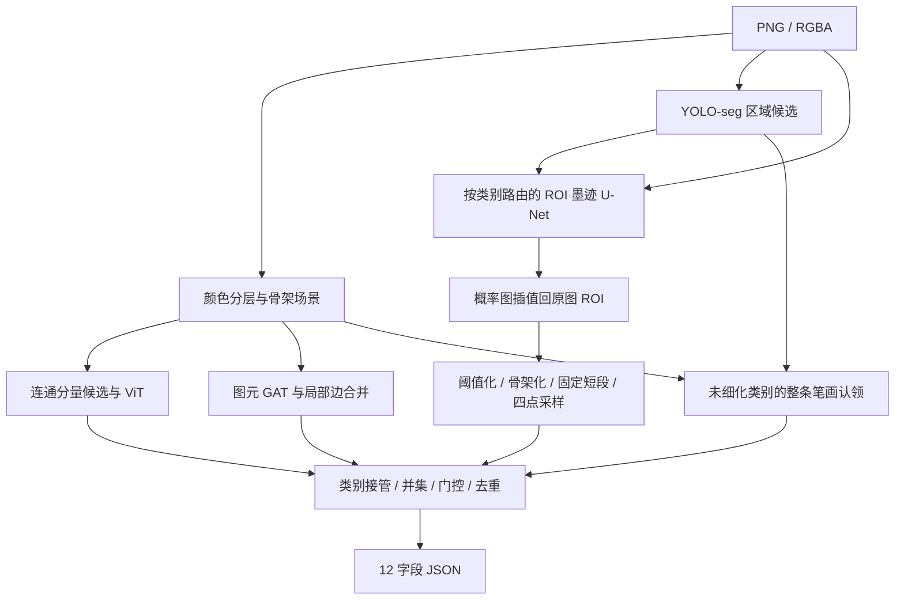
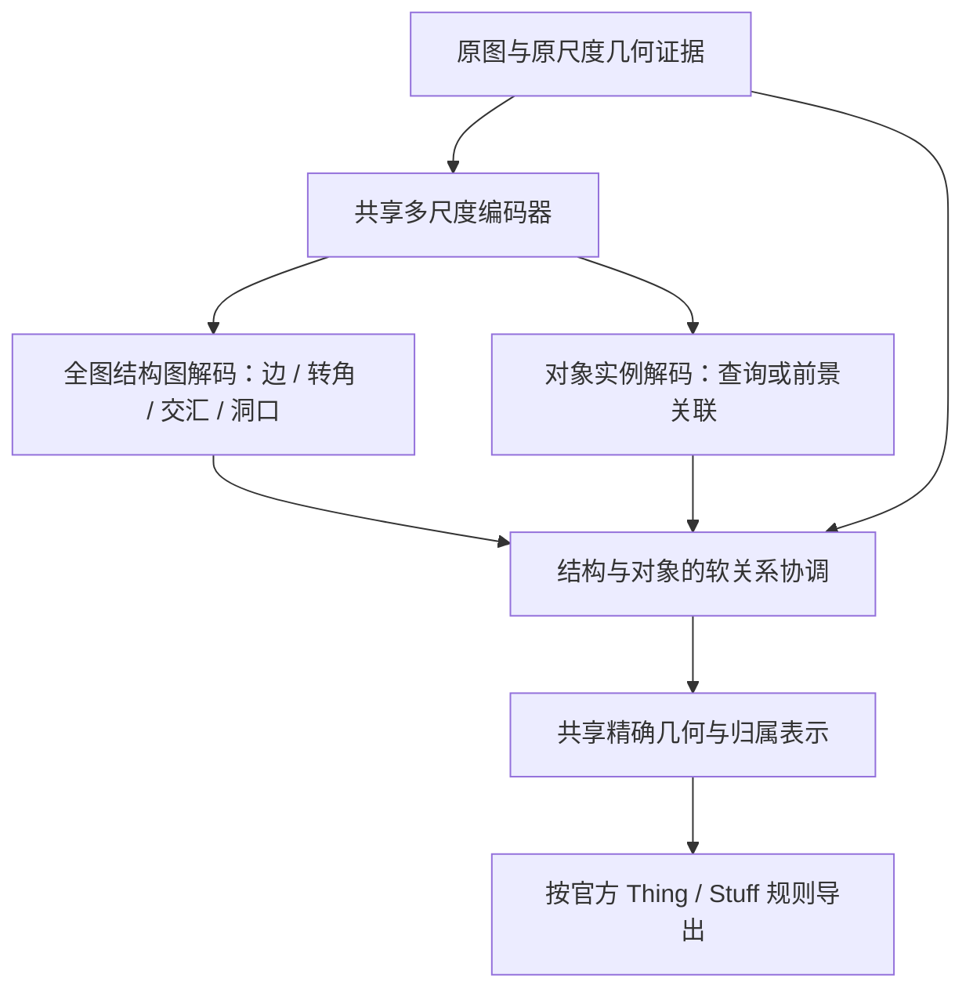

# 图纸分析赛道：从墙体漏检、符号过检到新的底层架构

> 2026-11-26 实施更新：本文的原分辨率几何与评分栅格监督方向已新增残差细节头，在冻结配置的三个来源隔离子集上分别提高 7.890/9.764/8.950 个 PQ 百分点。数据、训练和验收见 [带标签优化记录](LABELED_DATA_OPTIMIZATION.md)。下文保留 11-23 的历史分析与当时基线。

> 日期：2026-11-23。本文基于拉取后的最新代码、README、实验记录及源码审查编写。
> 最新远端实现：`origin/optimization/roi-ink-quality`，提交 `10f426a`；已合并到当前文档分支，合并提交 `92ef0ab`。
> 本文交付架构分析与实验计划。本次没有训练新模型，也没有重新测得竞赛数据 PQ；文中的历史成绩来自仓库记录，受控实验结果另行标明。
> 已纳入本轮补充：用户提供的原图/预测/GT/Overlay 四联图，以及“墙体完全漏掉、class 26/8/12 明显过检”的整体观察。图片未附对应预测 JSON、GT JSON 和生效配置，因此单图分析与源码结论分别标注。

## 1. 建议采用的方向

**下一轮建议采用“全图结构解码 + 符号实例归属 + 共享原分辨率几何”的架构方向。** 先核查墙体是否被现有输出策略删除，同时验证几何链路与实例身份损失，再比较实例查询、前景关联和图划分三种实例生成方式。

当前系统已经通过 ROI 墨迹细化取得明显进展，继续按 class 加专用模型、路由和门限，容易让系统复杂度增长快于实例召回。值得改变的是内部表示、实例形成方式和几何解码，而非只替换分类器。

建议的顺序是：

1. **先查完整输出覆盖。** 确认墙体的 GT 类别和计分身份，追溯原始候选、细化、路由和最终抑制；对 class 26/8/12 的过检区分多余实例、重复和几何污染。
2. **并行做几何与归属的最小验证。** 固定当前候选，比较原尺度几何与当前解码；在共用几何上尽早验证实例提示/查询。无需等完整几何系统建成后才检查归属问题。
3. **有条件推进图路线。** 只有可拆分原子笔画的 GT 归属实验显示表示空间足够，才投入新的图分组模型。
4. **补齐全图长结构建模。** 墙边、转角和洞口不应完全依赖局部符号检测框；将结构与对象作为两种建模粒度，最终遵循同一评分语义与输出协议。
5. **将直接矢量解码和全局逆向解释保留为研究支线。** 两者有更大改造空间，也需要更强的监督与验收。

本文提出七条路线 A–G。它们改变的基本假设不同，其中几何底座可供其余路线复用，G 将全图结构与对象组织成一个整体；不能把七条路线的收益相加，也不建议同时完整开发七套系统。

## 2. 拉取后的背景：目前已超过 16%，但实例召回仍低

### 2.1 版本和分数必须对应

本次先执行远端 fetch。`origin/main` 仍是 `6c22831`，较新的实现位于 `optimization/roi-ink-quality`，因此拉取并合并了该分支，保留当前已有文档提交。

阅读入口：[README.md](../README.md)、[OPTIMIZATION.md](OPTIMIZATION.md)、[R0_DIAGNOSTICS.md](R0_DIAGNOSTICS.md)、[METHOD.md](METHOD.md)。

| 仓库历史阶段 | 本地 PQ | 对应记录 |
|---|---:|---|
| 初始三分支 hybrid | 2.597% | README 历史基线 |
| 192/256 ROI 模型路由 | 16.250% | OPTIMIZATION §15.8 |
| 加学习式质量门控 | 16.886% | OPTIMIZATION §15.9 |
| 加专用 ROI 模型 | 18.235% | OPTIMIZATION §15.10；现有 R0 分析使用这一版预测 |
| 加统一类别条件模型的局部接管 | **18.768%** | 最新 README、OPTIMIZATION §16.4 |

以上均为仓库记载的本地 `test_final` 1000 张结果，不能等同于新获得的官方榜单成绩。用户描述的“16%”与前期记录吻合；本文以后续最新实现作为架构分析基线。

### 2.2 PQ 真正奖励什么

当前本地评分器 [cadvec/evaluate.py](../cadvec/evaluate.py) 的关键规则：

- Thing 0–29 按实例计分；Stuff 30–34 每图按类别合成一个段；35 忽略。
- 同类别之间按栅格掩码 IoU 匹配，必须**严格大于 0.5**。
- 数据集 micro 指标由累计 TP、FP、FN、匹配 IoU 求得；代码同时输出 macro，二者不可混用。
- 默认画布为 100×100、评分栅格为 1000×1000，线宽为 1 像素；正式比较使用 `dilate=0`。
- `Line` 和 `Arc` 均将四点连接成折线；`Circle/Ellipse` 按四点外接框画椭圆。几何解码必须尊重实际评分解释。

```text
S  = 所有匹配对的 IoU 之和
D  = TP + 0.5 × FP + 0.5 × FN
PQ = S / D
SQ = S / TP
RQ = TP / D
PQ = SQ × RQ
```

最新版历史记录：TP/FP/FN = **1687/3344/5642**，SQ = **68.754%**，RQ = **27.298%**。

据此，预测段数为 5031，GT 段数为 7329，precision 约 **33.53%**，recall 约 **23.02%**。这里的“段”包含 Thing 实例与 Stuff 类别段。

**高于 68% 的 SQ 不能说明几何问题已解决。** SQ 只统计成功匹配的少数实例；几何偏差使实例从 IoU 0.51 跌到 0.49 时，它会离开 SQ 统计，同时贡献一个 FP 和一个 FN。

用当前 SQ 的四舍五入数值做代数演示：

| 假设变化，其他条件保持不变 | PQ 变化约值 | 对架构选择的意义 |
|---|---:|---|
| 删除 100 个 FP | +0.153 个百分点 | 过滤有收益，但无法创造缺失实例 |
| 修好 100 个既有错误预测，分别匹配原有 FN；新增 IoU 均为 0.68754 | +1.113 个百分点 | 几何和归属修正可同时减少 FP、FN |
| 新增 100 个正确实例且不新增 FP；新增 IoU 同上 | +0.953 个百分点 | 候选与实例召回需要同步提高 |
| 已匹配实例平均 IoU 增加 0.05，匹配集合不变 | +1.365 个百分点 | 有收益，但受已匹配实例数量限制 |

这不是涨分预测。它说明目标应是**增加可匹配的完整实例**。即使无损删除全部 FP、其他量不变，PQ 也只有约 25.73%；若只提高 SQ、固定 TP/FP/FN，PQ 的上限则为当前 RQ，即约 27.30%。几何改进如果同时增加 TP，就不受后一个固定匹配假设限制。

仓库未提供独立的主办方原始评分器和完整规则。上述推导适用于当前本地实现；实施时应核对官方的栅格、坐标、忽略规则和汇总口径。

## 3. 最新架构的瓶颈在哪里

### 3.1 实际运行链路



默认引擎确实是 `hybrid`。目前启用的 ROI 权重按类别分工；“统一类别模型”已经存在，但它尚未替代完整系统。因此“增加一个统一 ROI U-Net”已经不是新的底层建议。

### 3.2 源码证据与架构含义

| 已确认的行为 | 源码位置 | 可能形成的限制；贡献量仍需实验 |
|---|---|---|
| ROI 网络输入 RGB 与类别 one-hot，没有目标实例掩码、目标点或实例查询向量 | `cadvec/roi_ink.py:41`、`:61`、`:240` | 两个同类实例裁剪高度重叠时，目标身份主要靠裁剪位置隐式表达，可能出现二义性 |
| GT 先在 1000px 栅格绘制，再 AREA 缩放到 192/256，之后做 3×3 膨胀 | `tools/build_roi_ink.py:36`、`:62`、`:124` | 评分细线变成低分辨率软占据目标；位置、线宽与连通性可能改变 |
| 推理概率先线性插值回原图 ROI，再骨架化 | `cadvec/roi_ink.py:266` | 插值恢复的是输出尺寸，不能恢复已经丢失的细线信息 |
| 阈值化、去除小分量、骨架追踪、每 6 个路径点切段、四点重采样 | `cadvec/roi_ink.py:94` | 多个离散步骤可能改变端点、交叉和弯折；固定段长没有针对最终栅格误差优化 |
| ROI 导出全部为 `command=0` | `cadvec/roi_ink.py:278` | 可用折线近似多种形状，但图元数量增加；椭圆可尝试更直接的参数表示 |
| ROI NMS 对加 padding 后的裁剪框做同类 IoU>0.5 去重 | `cadvec/roi_ink.py:297`、`:326` | 裁剪框重叠不等于两个细线实例重复，可能抑制密集邻近实例 |
| 图路线只保留最长 1200 条笔画，合并组最多 120 个节点 | `cadvec/pipeline_gat.py:25`、`:77`、`:112` | 短线和大实例存在结构性覆盖限制；局部并查集缺少全局排斥约束 |
| hybrid 合并与去重仍使用 400px、OpenCV 舍入栅格；正式评估使用 1000px、PIL | `cadvec/hybrid.py:16`、`:140`；`cadvec/evaluate.py:62` | “统一到评分尺度”的工作尚未贯穿全部路径，去重决策与最终细线重合可能不一致 |
| ROI 最优 checkpoint 与阈值按局部 Dice 选择 | `tools/train_roi_ink.py` 末段 | 模型选择尚未直接衡量“原图坐标→几何导出→严格实例匹配” |

两个需要分开的概念：

**实例归属**回答“哪些可见线属于同一个对象”；**几何恢复**回答“这些线应以什么坐标和图元输出”。现在的 ROI 模型同时猜两者，再用骨架后处理补齐表达，误差难以归因。新的底座应允许分别验证、分别替换这两个任务。

另一个约束是：PNG 中看起来平滑的真实弧线，与 GT 四点在评分器中连接成的折线，未必完全重合。让输出更贴原始 PNG，不一定让它更贴评分目标；训练必须同时检查原始墨迹和评分几何。

### 3.3 四联图给出的新证据

用户提供的图中，右上预测保留了部分窗、洁具、家具与一扇门的局部几何；左下 GT 和右下 Overlay 则显示更多墙体边线、隔间结构和门扇弧线。Overlay 中大范围仅有蓝色的结构线，说明这个样本存在明显的最终输出覆盖缺口；部分已预测物体附近也可见红蓝不重合与多余短线。

**这支持优先检查完整结构与实例几何，而非继续把所有问题解释成分类置信度不足。** 用户指出 class 26/8/12 在整体结果中明显过检，本文将其作为重点验证症状；仅凭这张图，部分 class 26/8 预测与 GT 的位置接近，尚不能确定它们是额外实例、重复实例，还是正确目标被杂线/坐标偏差污染。

| 需要区分的“过检” | 计分后果 | 对应底层动作 |
|---|---|---|
| 凭空多出的实例，与 GT 无对应 | FP | 前景角色识别、空对象监督、难负例 |
| 同一个 GT 被多个完整实例重复预测 | FP | 全局实例身份与去重 |
| 几何对应另一个类别的目标 | FP + FN | 实例形成后校正语义和路由 |
| 正确目标混入墙线/尺寸线，或多个目标粘连 | FP + FN | 原子归属、可拆节点、实例竞争解码 |
| 正确目标位置附近，但细线坐标不重合 | FP + FN | 原分辨率几何、精确坐标与评分解码 |

因此，多余红线并不全部等于“该删掉的实例”。对于后两种情况，删掉预测会保留 FN；修好预测才可能把 FP/FN 成对变为 TP。3048 个最终无候选 FN 与 1159 个多余笔画/错位 FP 是 GT 侧和预测侧的统计，两者可能关联，不能相加当作独立可恢复实例数。

还应核对可视化与评分范围是否一致：左下 GT 或蓝色 Overlay 如果画出了被评分器忽略的图元，肉眼缺线不一定全部计入 PQ。四联图应额外提供“全部 GT”和“实际计分 GT”两个开关，并对未匹配实例标注 IoU、计分状态和来源阶段。

### 3.4 墙体漏检：先排除输出路径硬删除

已核对的默认配置：

- `infer.py` 的 `--suppress-classes` 包含 **30、34**；`weights/class_policy.json` 还抑制 **33、34**，两处作用阶段不同。
- 当前 ROI 细化路由面向 Thing，统一模型的实验也覆盖 0–29；它不能自然补回整图 Stuff 几何。
- `hybrid.merge_final` 会按类别删除，再追加启用的 ROI 实例；当前 Thing ROI 的并集不会恢复被删的 Stuff。

**这不证明墙一定是 30 或 34。** 仓库常量定义了 Thing/Stuff 区间，但没有足够的官方类别名称映射证据，不能根据渲染颜色或公开数据集编号猜测本赛题墙的 ID。也不能把默认参数视为用户这张图的实际命令配置。

先做一次不训练的核查：逐类别渲染 GT，确定墙的 `semanticId`、`instanceId` 和实际计分段数；在抑制前后导出墙候选；用同权重做仅恢复已确认墙输出路径的对照。若抑制前存在正确墙候选，属于策略造成的损失；若抑制前也没有，再定位颜色前景、候选构建、分类或长结构表示。**关闭一个抑制开关的收益不能记作新架构收益。**

如果墙在正式定义中属于 Stuff，必须每图按类导出并保留 `instanceId=-1`；若属于 Thing，则按规则提供实例身份。若发现可视化画出的墙在本地被当作 Thing 且实例号 -1 而跳过，应先对齐数据与评分规则，不能擅自重新解释 GT。

墙占据图像面积很大，不代表在 micro PQ 中具有同等权重。若每图墙只合并成一个 Stuff 段，恢复的是计分段数，而非墙线像素数。设在不影响既有匹配的条件下恢复 `m` 个 FN，新增匹配平均 IoU 为 `q`，同时增加 `f` 个 FP，则当前 micro 口径的场景估算为：

```text
PQ_new ≈ (1159.88 + q × m) / (6180 + 0.5 × (m + f))
```

例如新增恢复 100 个墙段、q=0.7、无新增 FP，约从 18.77% 到 19.74%，不是因墙线铺满整图就必然大幅跃升。macro PQ 则取决于官方纳入平均的类别集合，不能套用此公式。

## 4. 现有 R0 诊断有价值，但不能直接决定换检测器

[R0_DIAGNOSTICS.md](R0_DIAGNOSTICS.md) 基于 **18.235% 版本**，Thing-only 为 TP/FP/FN = 1642/3367/5246。其启发式标签中，无候选 3048、严重错位 1119、近阈值 1036、错类 40、碎裂 3。

“无候选或严重错位占 FN 约 79.43%”可以作为追查线索，但应加上以下边界：

1. **这里是最终 JSON 无候选。** 原始 YOLO proposal 可能存在，只是在路由、ROI 解码、NMS 或质量门控后消失。不能直接把 3048 个 FN 解释为检测器漏检。
2. **错误桶不是独立因果归因。** `wrong_class=40` 不等于分类错误总共只有 40；`fragmented=3` 也不能证明没有碎片化。当前标签依赖最佳重叠和两个 IoU 之和等启发式。
3. **匹配实现不完全一致。** R0 先最大化原始 IoU 再过滤阈值；正式评估先屏蔽不合格边并加入虚拟节点。应复用正式评估的匹配逻辑。
4. **诊断样本由预测文件驱动。** 缺少预测文件的 GT 不会进入当前 R0 统计，必须单独核对完整图纸清单。
5. **“忽略类别的定位上界”是逐 GT 独立最佳覆盖。** 一个预测可被重复使用，不能直接解释为可实现的一对一召回率。
6. **坐标与预筛仍需核对。** `load_json` 只保留四个图元字段，R0 后续读取宽高会回退 100；bbox IoU 阈值还可能排除部分细长结构。全部 100×100 时前者不改变结果，非默认画布应专门验证。

这些行为见 `tools/diagnose_r0.py:71`、`:84`、`:136`、`:173`、`:283` 与 `cadvec/evaluate.py:59`、`:148`。

新的诊断应在以下阶段保留快照：

```text
原始 proposal
  → proposal 筛选
  → ROI 网络概率
  → 原分辨率实例墨迹
  → 几何导出
  → NMS / 路由 / 门控
  → 最终 JSON
```

区域阶段分别统计框覆盖、区域召回；墨迹/几何阶段使用严格 mask IoU。每阶段同时报告忽略类别的独立覆盖与一对一匹配结果，并记录实例被哪一步删除。**框覆盖率不能替代细线实例召回率。**

## 5. 本次受控检查：几何往返本身可以让实例跌出匹配

本次没有竞赛数据，使用五个人工构造的单实例形状检查现有函数：水平线、斜线、折角、四点弧折线、椭圆。画布 100×100，PIL 栅格 1000×1000，全部实例类别相同。

比较两条路径：

- **原尺度 GT 路径**：理想 GT 细线 mask → 当前 `vectorize_mask` → JSON 四点图元 → 当前评分栅格。
- **ROI 标签路径**：调用现有 `crop_instance`，SIZE=256、PAD=0.30 → 3×3 膨胀 → 线性插值回原 ROI → 同一矢量化和评分。把软标签当概率，以 0.5 阈值解码。

| 构造形状 | 原尺度 GT 路径 IoU | ROI 标签路径 IoU | 是否跨过 0.5 |
|---|---:|---:|---|
| 水平线 | 1.000000 | 0.986755 | 两条路径都匹配 |
| 斜线 | 1.000000 | 0.072000 | ROI 路径失配 |
| 折角 | 0.992032 | 0.307692 | ROI 路径失配 |
| 四点弧折线 | 0.809211 | 0.478548 | ROI 路径失配 |
| 椭圆 | 0.775916 | 0.281124 | ROI 路径失配 |

**这不是模型分数，也不是网络能力的严格上限。** 网络输出可以不同于软标签，阈值与裁剪尺寸也会影响结果；五个构造样例不能代表真实分布。它证明的是：即使从理想 GT 墨迹出发，现有表示与解码组合也可能产生很大误差，应该先测真实图纸的同类往返实验，再决定扩大模型。

原尺度 GT 路径也不是完全无损：椭圆被拆成 142 条短折线，严格 IoU 约 0.776。由此可见，**保留高分辨率与改进几何导出是两项工作**，只放大 ROI 仍不足以解决全部问题。

## 6. 七条路线共用的底座：保留几何，延后不可逆决策

建议建立一个内部图纸表示，最后一步再转换为比赛 JSON：

```text
Drawing
  transforms：原图、切片、ROI、画布、评分栅格之间的精确变换
  evidence：原始 RGB/alpha、覆盖率、局部图像特征
  atoms：稠密路径、可拆分短段、端点/交点、几何来源与置信度
  instances：实例查询或全局 ID、原子归属概率、语义与质量
  stuff：覆盖整图的类别几何，不依赖 Thing 检测框
  exporter：按评分规则选择切段、四点与图元指令，校验 12 字段
```

要点如下：

- 稠密路径、原始曲线类型和候选原子保留到实例确定之后，避免一开始就只剩四个采样点；同一实例可按规则导出多个四点图元，不是将任意长路径压成一个四点图元。
- 同一份可见几何被多个假设使用时，先保留多假设。是否最终限制单一归属，应根据 GT 连续路径/共线区间的共享统计决定，排除仅在交叉像素重叠的假共享。
- 语义是实例的属性，不能成为决定所有几何可达性的第一道硬门。
- 为严格评分统一一个权威渲染接口；辅助训练可使用软距离场或低分辨率特征，但明确其代理性质。
- 1000px 评分栅格与原始 PNG 分辨率可能不同，二者都需保存变换；“原分辨率”不等于把所有坐标硬写成 1000。
- 任何选段和优化在正式推理中只使用 PNG 与模型预测；GT 仅用于训练、合法本地评估和 oracle 诊断。

## 7. 路线 A：原分辨率中心线场与几何解码

**改变的假设：细线几何不应由低分辨率膨胀 mask 独自承载。**

架构：低分辨率上下文分支判断对象范围；细节分支在原图 ROI 或重叠小块预测目标中心线、切向、端点/交点与局部坐标偏移。实例身份由检测提示或实例查询提供，几何由共享细节解码器恢复。

实施要点：

1. 输入增加目标实例提示，例如检测掩码、中心热图或查询特征，解决“同一裁剪里要恢复哪一个对象”。
2. 细线和难点优先采样，不把计算均匀花在空白区域；保留邻近前景和残差候选，避免前景预筛成为召回瓶颈。
3. 将宽 mask 作为辅助监督，同时学习与评分目标对应的中心线/距离场；用中心线、方向和几何渲染共同约束。
4. 根据曲率、端点与评分重投影误差自适应切段，替换固定每 6 点切段。精修像素相位和坐标约定，不能全局盲目添加或删除 0.5。
5. 在支持充分时恢复直线、圆或椭圆；Arc 必须按评分器的四点折线规则验证。更多曲线类型不自动意味着更高分。

可借鉴 [PointRend 的自适应点预测](https://openaccess.thecvf.com/content_CVPR_2020/html/Kirillov_PointRend_Image_Segmentation_As_Rendering_CVPR_2020_paper.html)，但本项目应沿细线而非仅沿实心物体外轮廓采样。拓扑辅助损失可参考 [clDice](https://arxiv.org/abs/2003.07311)；保持连通不能替代正确实例划分，也不能鼓励跨对象错误连线。

**最小实验：** 冻结当前 YOLO 框、类别和输出候选集合，仅替换几何链路。先做 GT 墨迹往返，再对相同模型概率比较当前解码与原尺度中心线解码，最后才训练细节分支。

**验收：** 严格实例 IoU 分布、0.3–0.5 区间转 TP 数、TP/FP/FN、整体 PQ、图元数与时间。若只提高容差 IoU 或视觉平滑度，暂不扩大投入。

**风险：** 中心线正确但归属错误仍会失配；图像真弧与四点评分折线不一致也可能限制纯图像拟合。

## 8. 路线 B：实例查询直接分配原子几何

**改变的假设：实例是从候选框内独立长出的 mask。改为由整图实例查询对可见原子进行归属。**

```text
全图上下文 + 高分辨率线/点 token
  → 一组实例查询
  → 查询与原子的归属概率
  → 每个实例的语义、存在概率、质量
  → 共享几何导出
```

每个原子可以是短路径或小段采样点，附带原图特征、位置、方向和覆盖率。实例查询一次观察多个不连通部件，可把同一符号的断开笔画组成一个对象。

训练采用实例集合匹配、实例存在性、归属和语义联合监督，保留未匹配查询作为空对象。对于拥挤交叉处，按标注事实选择独占分配或受约束多归属。给没有进入初始原子集合的笔画保留补充生成通道，否则召回会被前处理锁死。

机制参考 [Mask2Former](https://arxiv.org/abs/2112.01527) 的实例掩码查询和 [SymPoint](https://arxiv.org/abs/2401.10556) 的图元点表示。这里使用的是从 PNG 恢复的、带不确定性的原子，不能直接照搬原生 CAD 图元输入的性能预期。

**与已有统一 ROI 模型的区别：** 统一的是全图实例身份和几何归属，模型不再只接收类别 one-hot；多个同类实例拥有不同查询，并共同处理重复与竞争。

**最小实验：** 先用检测器初始化查询，冻结几何底座，比较独立 ROI 与查询归属；若有效，再加入不依赖检测框的自由查询。先局部 ROI 多实例训练，再验证整图和跨片拼接。

**验收：** 相同原子上的一对一实例召回、过合并/过拆分、目标身份混淆、严格 PQ。查询数量按实例数量分布设置并报告截断，不沿用未经验证的固定 top-K。

**风险：** 稀疏注意力可能漏掉细线；查询数不足限制召回；原子集合有损时，换查询头也不能恢复丢失几何。

## 9. 路线 C：前景中心投票与关联，构建无框实例系统

**改变的假设：必须先检测一个框，才能生成一个实例。**

在细线前景位置预测：目标实例中心、指向中心的偏移、实例嵌入、邻近原子的同实例关联；根据投票峰值和关联聚合实例，再判断语义，最终复用同一几何导出器。

与路线 B 不同，这条路线从局部证据向实例聚合，不维护固定数量的全局对象查询。它适合做成本较低的独立对照，尤其用于判断检测框依赖是否限制了输出覆盖。

参考 [Panoptic-DeepLab](https://openaccess.thecvf.com/content_CVPR_2020/html/Cheng_Panoptic-DeepLab_A_Simple_Strong_and_Fast_Baseline_for_Bottom-Up_Panoptic_CVPR_2020_paper.html) 的类别无关中心和偏移机制；具体应用建议在前景点或原子上预测，而非照搬城市实心区域分割。

实施时，同一符号的不连通部分可投票到相同中心；跨度大的多部件实例可使用多个局部锚点，再预测锚点的同实例关系，中心不要求位于前景线条上。Stuff 走整图语义几何支路，不生成实例中心。交点上若存在多实例叠加，采用方向分支或多假设原子，避免强制每个图像像素只能拥有一种实例身份。

**最小实验：** 先给 GT 前景支持，预测中心与实例关联；确认实例身份可以学会后，再换回真实恢复前景。这样可以区分前景漏线和聚合失败。

**验收：** 中心召回、同类相邻实例可分性、不连通部分召回、严格 PQ，以及跨图纸密度的稳定性。

**风险：** 相邻中心拥挤、中心位于符号空白处、长距离不连通结构和投票尺度差异。只用中心距离聚类可能重现当前粘连问题，因此必须保留关联证据。

## 10. 路线 D：可拆分原子图与全局约束划分

**改变的假设：恢复出的整条笔画是不可拆节点；几条高分边的传递闭包就代表一个实例。**

新图表示在交点、实例竞争边界、曲率突变处保留切分选择，节点保存稠密几何。边不仅预测“连接”，也预测“排斥”；加入跨空隙的长距离关联及端点、方向、图像上下文。

实例解码可比较约束相关聚类、multicut 或图上的实例查询，替换单纯边阈值并查集。并非所有图都需要求精确全局最优，可先在局部冲突区域做小规模近似划分。

相交、平行、邻近和连通本身都不是硬同实例证据。大部分关系应作为可回退的软约束，避免错误的硬连接通过传递闭包扩大污染。

[GAT-CADNet](https://openaccess.thecvf.com/content/CVPR2022/html/Zheng_GAT-CADNet_Graph_Attention_Network_for_Panoptic_Symbol_Spotting_in_CAD_CVPR_2022_paper.html) 提供了图上实例关系建模的依据；现项目已存在 GAT，新增价值必须来自**节点表示、可拆能力和全局解码**，不能仅表述为“引入 GAT”。

大图采用局部稀疏邻接与上层关系图，替代全体节点两两距离及 dense adjacency；按覆盖和局部密度分配预算，避免只保留长线。重叠分块必须通过原图坐标和几何证据建立全局 ID，不能仅因两个片段相近就合并。

**最小实验分两步：**

1. 给原子 GT 归属，直接导出其观测几何，测表示可达性；另测同实例是否能在候选边图中互相到达。
2. 固定同一批边概率，仅替换并查集和带排斥约束的解码，测实例过合并与 PQ。

**验收：** 节点覆盖、可达性、GT 归属几何上界、真实分组 PQ，以及解除 1200 节点限制后的净收益。

**风险：** 初始切段有损时图模型无法补回几何；过度依赖连接性会误合交叉对象；严格单一图划分可能不适合共享笔画标注。

## 11. 路线 E：分层矢量集合解码，直接预测评分几何

**改变的假设：必须先生成二值 mask，再骨架化回矢量。**

架构采用“实例层—图元层”两级集合：实例层预测存在性和语义，图元层预测该实例的路径、四点参数及图元指令。优先使用**引用已有原子 + 坐标修正 + 少量补线**，再探索完全生成，减少幻觉与长序列负担。

训练同时约束图元集合、端点、方向、实例归属和渲染结果。点序反转、等价图元拆分、闭合路径起点等都要允许等价匹配，避免网络为任意序列顺序付出学习成本。

评分器的硬栅格化不可直接提供稳定梯度，可使用软渲染或距离场做代理；最终模型选择仍必须通过精确 PIL 栅格和一对一 PQ。不能把可微代理改善直接当作比赛分数改善。

[Deep Vectorization of Technical Drawings](https://www.ecva.net/papers/eccv_2020/papers_ECCV/papers/123580579.pdf) 可借鉴图元预测与几何精修的组合。其方法和数据条件不构成本赛题收益或外部训练数据可用性的证明。

**最小实验：** 给定 GT 实例框与类别，只比较现有 mask→骨架几何头和图元引用/四点修正头。先验证能够恢复评分表示，再接真实框与实例归属。

**验收：** GT 条件下的几何严格 IoU、真实预测下的 PQ、漏线/多线率、图元数和推理成本。

**风险：** 直接坐标预测抖动、等价表达过多、实例复杂度大时截断；“像 CAD”的输出不一定与 GT 评分几何一致。

## 12. 路线 F：全局候选解释与局部逆向渲染

**改变的假设：每个局部预测可以独立接受，最后依靠置信度排序即可得到合理整图。**

把当前各分支产生的实例作为初始解释，由全局选择器协调：哪些候选重复解释同一笔画、哪些候选存在冲突、哪些细线没有被任何对象解释。必要时只在冲突 ROI 做拆分、合并或坐标修正。

目标可包含预测墨迹支持、未解释前景、重复解释、实例数量和几何复杂度。必须建模文字、尺寸线、墙线和忽略区域，不能为了覆盖所有墨迹而虚构 Thing 实例。

几何连续参数可参考 [DiffVG](https://people.csail.mit.edu/tzumao/diffvg/) 做局部可微精修；离散实例归属、拆并和拓扑仍需显式搜索或关系预测。重建 PNG 的目标与重建四点评分几何的目标应分开记录。

**最小实验：** 冻结所有候选，先只改变候选选择与冲突协调；另做合法本地 GT oracle 选择，测候选池最多能提供多少额外 TP。只有候选池存在可兑现的额外 TP，才继续加入拆并和逆向渲染。

**验收：** 候选池可达 PQ 与实际选择 PQ 的差距、重复/冲突减少、全局 PQ 和每图优化耗时。

**风险：** 图像重建正确不保证实例身份正确；现有候选池本来缺失时无法凭选择器补救；优化可能吸附到错误背景线。应作为支线，不作为下一轮唯一投入。

## 13. 路线 G：全图结构解码与符号实例联合建模

**改变的假设：一张图只要检测出足够多的局部符号，就自然获得完整图纸解析。**

针对四联图暴露的墙体缺失，建议让全图长结构和紧凑对象成为两种建模粒度，共用图像特征、原子几何与坐标系统。它不是按 class 再添加一排专用检测头，而是改变场景的组织方式：连续边、交汇和洞口由全图结构解码器处理，符号的实例身份由对象解码器处理。



关键设计：

1. **结构候选来自全图，覆盖低饱和、灰色和长距离笔画。** 保留 RGB/alpha/覆盖率，不依赖“只在检测框里恢复线条”；颜色是证据而非决定墙身份的硬规则。
2. **结构图预测可见边界和连接关系。** 学习墙边的连续性、双边界、厚度线索、转角及洞口关联；几何先验采用软约束，不能把斜墙、弧墙或真实开口规整掉。
3. **结构表示必须对应评分几何。** 如果 GT 画的是墙的双侧边界，墙中心线只能作为辅助潜变量，不能直接用一条中线替代两条评分线；也不能输出实心墙 mask 代替线图元。
4. **符号分支显式识别原子角色。** 让同一个 ROI 内的证据区分目标本体、结构上下文、邻居对象、文字/尺寸线和忽略部分，防止这些线全部被 class 26/8/12 的实例收走。
5. **协调是软关系，避免先减去墙线。** 墙与窗、门之间有共线或重叠时，先保留归属选择；错误结构预测不能触发“附近对象一律删除”或“所有墙像素从符号里扣掉”。
6. **结构分支独立保证输出覆盖。** Stuff 不参与 Thing 的 top-K、框 NMS 或符号置信度竞争；如果某类结构按官方定义是 Thing，依然需要学习相应实例划分，不能擅自统一成 Stuff。

结构图机制可参考 [HEAT](https://openaccess.thecvf.com/content/CVPR2022/html/Chen_HEAT_Holistic_Edge_Attention_Transformer_for_Structured_Reconstruction_CVPR_2022_paper.html) 的角点、候选边和全局关系建模。其室内实验使用点云投影密度图，输入、监督和评价均不同于本赛题；这里只借鉴图结构推理，不照搬预训练模型或论文成绩。

**最小实验：** 完成 §3.4 的输出路径核查后，固定原对象分支，只训练/替换全图结构解码；先量化结构覆盖和新增计分段，再启用对象—结构软协调。这样可以分别报告“解除错误删除”“新增结构能力”“减少符号串线”的收益。

**验收：** 墙的实际计分 TP/FP/FN 与 PQ、结构边界覆盖/精度、长边断裂、洞口保留、符号混入结构线的比例，以及整体 micro/macro PQ。纯像素覆盖增加但没有提升计分段质量，不能算通过。

**风险：** 文本、标注引线和家具轮廓也有长直线；全图结构错误可能污染符号。大量墙线只对应少量 Stuff 段时，视觉改善大于 micro PQ 改善，因此必须保留双重验收。

## 14. 路线对照与优先级

| 路线 | 主要处理的损失 | 对现有检测器的依赖 | 改造量 | 开始前最重要的证据 |
|---|---|---|---|---|
| A 原分辨率中心线与几何 | 缩放、骨架、采样和坐标导致失配 | 首轮可完全复用 | 中 | 真实 GT/概率往返损失明显 |
| B 实例查询归属 | 同类实例身份、断开部件、候选竞争 | 可从检测初始化逐步解除 | 中高 | 同一几何底座有较高可达召回 |
| C 中心投票与关联 | 框依赖、实例生成覆盖 | 不依赖框 | 中 | GT 前景上的实例聚合能够学会 |
| D 原子图全局划分 | 整条笔画归属、传递合并、长度截断 | 不必依赖框 | 中高 | 原子几何与候选图可达性足够 |
| E 分层矢量集合 | mask 到矢量的表示断层 | 可先用 GT/预测框 | 高 | GT 条件几何头优于当前解码 |
| F 全局候选解释 | 分支冲突、重复、错误选择 | 首轮复用候选池 | 中高 | 候选池 oracle 显著优于当前选择 |
| G 全图结构与对象联合 | 墙体覆盖缺口、长结构与局部对象混淆 | 结构支路不依赖框 | 中高 | 墙的计分身份与输出缺失阶段已确认 |

**建议主线：输出路径核查 → A 的最小几何原型与实例身份验证 → G 的全图结构覆盖 + 共用几何上的 B/C 对照。D 作为条件竞争路线，E/F 小规模探索。** 这是实验投入建议，尚无证据证明其中某条必然优于其他路线。

如果阶段快照发现原始 proposal 已足够、损失主要发生在几何导出，就先做 A/E；如果候选本身缺失，再做 B/C 的自由实例生成。若主要是多候选选择冲突，可以优先试 F 的轻量选择层。不要在诊断前把“无候选”全部归咎于同一模块。

## 15. 新的研发路线：先测上限，再选择架构

下表是建议的工作包，均尚未在真实竞赛数据上执行。人日为开发量级估计，训练耗时另计，假设已有合法数据和 GPU。

| 阶段 | 任务与交付 | 继续投入的条件 | 工作量估计 |
|---|---|---|---|
| P0 冻结新基线 | 保存 10f426a 代码、权重哈希、生效配置、数据清单；重放严格 PQ 与完整错误摘要 | 可以稳定复现同一版本，数据范围明确 | 0.5–1 人日 |
| P1 损失分解 | 墙的 ID/计分/删除路径；完整阶段快照；GT 几何往返；any-class 一对一；过检机制与共享线统计 | 明确墙在哪一步消失、符号 FP 属于何种机制 | 1–2 人日 |
| P2 共用几何最小原型 | 原尺度证据、精确变换、稠密路径保留、共享评分渲染、自适应切段；同步做目标身份提示对照 | 严格 PQ 改善，或证实当前几何并非主瓶颈 | 2–4 人日起 |
| P3 实例生成竞赛 | 共用底座上做 B 和 C 的小模型；D 根据原子 oracle 决定是否加入 | 同预算、同数据、同解码器下有稳定净收益 | 每条 3–5 人日起 |
| P4 全图结构与对象协调 | 路线 G：结构边/交点/洞口解码；符号原子角色；独立 Stuff 覆盖；分块全局身份 | 结构计分恢复、符号串线减少，整体 PQ 改善 | 3–5 人日起 |
| P5 研究支线 | E 的 GT 条件几何头，或 F 的固定候选全局选择；每次只选择一个验证问题 | 对应 oracle 显示空间且实测兑现 | 2–5 人日起 |
| P6 最终验证 | 冻结参数，在真正未参与决策的数据/官方提交上确认，完成离线与资源检查 | 整体 PQ、稳定性、成本满足提交要求 | 1–2 人日 |

首轮小实验建议选择约 100–200 张代表图，涵盖目标大小、线密度、弧线、同类相邻、跨色实例和无目标图。数量是实验设计建议，不是当前已有划分。不得只选择容易涨分的类别或图纸。

### 15.1 必做的八个辨别实验

| ID | 固定什么 | 只改变什么 | 可以回答的问题 |
|---|---|---|---|
| E0 评分契约 | 相同 GT | 原始导出、几何解析、不同坐标变换 | 本地监督与输出是否理解同一几何 |
| E1 几何往返 | GT 实例身份、类别 | 原尺度、192/256 标签、当前/新矢量化 | 表示与解码损失在哪里 |
| E2 阶段保留 | 当前所有权重和输入 | 各阶段快照，不改变预测 | FN 在检测、细化、去重还是门控产生 |
| E3 身份提示 | 相同候选框与骨干 | 类别条件，对比类别+实例提示/查询 | 重叠同类 ROI 是否缺少可辨识目标信息 |
| E4 原子归属 | 相同原子几何 | GT 归属、并查集、预测全局归属 | 该继续改几何、图表示还是分组算法 |
| E5 候选池选择 | 相同分支候选 | 当前路由、GT oracle 选择、学习式全局选择 | 融合复杂度有没有可兑现的实例收益 |
| E6 墙体输出路径 | 相同权重、数据和其余配置 | 只恢复确认被错误删除的墙输出；保存抑制前后快照 | 无需新模型能恢复多少墙段；缺口是否真的在候选生成 |
| E7 结构与符号协同 | 同一结构/对象分支、相同候选 | 独立输出与软角色协调 | class 26/8/12 的 FP 能否通过归属修正转为 TP |

Oracle 只用作合法本地诊断。E1/E4/E5 的结果依赖各自固定条件，不能直接相加，也不应称作整套系统的严格数学上限。

### 15.2 验收应围绕实例与成本

建议所有路线共用实验表：

| 实验 | 数据/权重/配置哈希 | PQ micro / macro | SQ / RQ | TP / FP / FN | 近阈值转 TP | 缺文件/空预测/异常 | 秒/图、显存、图元数 | 结论 |
|---|---|---|---|---|---|---|---|---|
| 待实施 | 待记录 | 待测 | 待测 | 待测 | 待测 | 待测 | 待测 | 待定 |

同时按目标大小、图纸密度、同类邻近、弧线和来源分解；类别结果保留为公平性和退化检查，不再据此维护无休止的专用架构。

采用按原图来源分组的配对 bootstrap 或重复划分估计增益区间。达到什么绝对 PQ 不作预先承诺；只改善局部 Dice、bbox mAP、边 F1 或容差栅格结果，不算端到端验收通过。

## 16. 数据、训练和运行上的必要约束

### 16.1 重新切分不能自动得到从未见过的测试集

最新记录称 `test_final` 重新分成 calib 300 / hold 300 / final 400，且 final 未参与本轮选择。但该集合此前已用于多轮类别、门限与模型路由比较，因此不能仅凭重新命名就宣称这 400 张在整个研发历史上从未影响选择。

应保存历史使用记录，将“本轮未参与选择”和“历史上从未参与决策”区分开来。真正的泛化证据需要未参与决策的数据或后续官方评测；在此之前，本地增益按开发结果报告。

`tools/build_splits.py` 对 train/test 两个集合分别做 dHash 分组，尚不能保证两者之间无同源样本；dHash 相近也不等于来源相同。需要统一来源去重、跨集合查重并抽检，冻结原图分组及样本清单。数据允许用途以赛事原始规则为准。

### 16.2 训练监督应对齐完整任务

- 保留训练已有的 GT 框扰动和难负例，不把它们当作尚未做过的新优化。
- 新增检测框/实例查询提示时，提示与图像、标签同步增强；覆盖相邻同类实例和穿框背景线。
- 宽 mask、拓扑、距离场可辅助训练，严格几何评估始终使用评分表示。`label_qa.py` 的跨栅格差异提示采样敏感性，不能直接证明 GT 错标。
- 先在少量训练图上验证“能否学会”，再扩大数据和模型；模型选择增加端到端严格 PQ，而非只依赖局部像素指标。
- Thing 需要实例身份，Stuff 需要整图覆盖，不能把 Stuff 当作更多 Thing 检测类别附加到 ROI 系统。

### 16.3 资源有限时的实现方式

使用小型共享编码器、重叠切片、前景 token、局部稀疏关系、ROI 批处理和梯度累积，避免全图 1000×1000 token 的全注意力。分块不是随意裁开图纸，需要坐标逆变换、边界上下文与跨片实例合并。

对比路线同时记录实际 GPU 小时、峰值显存、候选/原子预算和推理时间。RTX 3060 6GB 是仓库历史训练设备，不代表本次已确认可用设备；正式架构规模应按实际硬件和比赛资源限制确定。

仓库声明正式推理离线、参数总量不超过 5B、仅用允许数据，并输出规定 12 字段 JSON。新增模型需保留离线权重和参数清单；外部论文只借鉴机制，不自动授权外部数据或预训练。

## 17. 本次实际验证与复现入口

| 本次检查 | 结果 | 证据边界 |
|---|---|---|
| 拉取远端最新实现 | 已合并 `10f426a`，生成 `92ef0ab` | 当前保留原文档分支，并获得最新优化代码与权重 |
| 用户四联图与默认输出策略交叉检查 | 已确认可见结构缺失；默认抑制含 30/34，ROI 面向 Thing | 未提供该图 JSON 与实际配置，尚不能确定墙的 ID、计分身份或被删除阶段 |
| `python -B -m pytest tests -q -p no:cacheprovider` | **56 passed，21.05s** | 既有测试通过，不代表真实数据 PQ 或完整默认推理成功 |
| 五种构造几何的往返实验 | 结果见 §5，可用附录代码复现 | 没有训练和真实图纸分布，不能据此估计涨分 |
| `python -B infer.py --check-only` | **失败：当前环境缺少 ultralytics** | 最新 requirements 已列出该依赖；不能继续沿用旧提案“依赖未声明”的判断 |
| 真实数据推理、全量重评、训练、Docker | 未执行 | 仓库未包含竞赛数据，本次任务交付文档 |

后续在补齐当前项目依赖、放置合法本地数据后，可使用现有入口冻结基线。以下命令从仓库根目录运行，路径替换为实际路径；不表示本次已执行成功：

```bash
python infer.py --check-only
python infer.py --input ../datasets/test_final --output _work/baseline_pred --engine hybrid --weights weights --workers 1 --strict-exit --summary _work/baseline_summary.json
python tools/svg_to_json.py --svg-dir ../datasets/test_final --out _work/gt_json --skip-validation
python -m cadvec.evaluate --gt-dir _work/gt_json --pred-dir _work/baseline_pred --raster-size 1000 --dilate 0 --json-out _work/baseline_eval.json
python tools/diagnose_r0.py --pred-dir _work/baseline_pred --gt-dir _work/gt_json --raster 1000 --out _work/r0_report.json
```

`--skip-validation` 仅用于 GT 导出：部分 Thing 真值实例号 -1 会被评估跳过，但不满足预测提交校验。预测输出仍必须严格校验。R0 命令生成的是当前启发式诊断，解释时必须遵守 §4，不能代替正式评估。

先查看摘要中的错误、分支加载情况、空预测和覆盖率，再解读分数。单图失败后生成合法空 JSON 并不代表该图推理成功。

## 附录：构造几何往返实验

以下为 §5 的最小复现 Python 代码，在项目根目录运行；不写入数据或权重文件，不下载模型。它直接调用当前标签裁剪与矢量化函数。

```python
import cv2
import numpy as np
import tools.build_roi_ink as builder
from cadvec.evaluate import _segments
from cadvec.roi_ink import vectorize_mask

builder.SIZE = 256
cases = {
    "horizontal": (0, [(20, 40), (30, 40), (40, 40), (50, 40)]),
    "diagonal": (0, [(20, 20), (30, 30), (40, 40), (50, 50)]),
    "corner": (0, [(20, 20), (20, 35), (40, 35), (40, 50)]),
    "four_point_arc": (1, [(20, 40), (22.68, 30), (30, 22.68), (40, 20)]),
    "ellipse": (3, [(20, 35), (35, 20), (50, 35), (35, 50)]),
}
image = np.full((1000, 1000, 3), 255, np.uint8)

for name, (command, points) in cases.items():
    gt = dict(semanticIds=[2], instanceIds=[0], commands=[command],
              args=[[v for point in points for v in point]])
    masks, _ = _segments(gt, (100, 100), 1000)
    mask = masks[(2, 0)].astype(np.uint8)
    ys, xs = np.nonzero(mask)
    box = tuple(map(float, (xs.min(), ys.min(), xs.max(), ys.max())))
    side = max(box[2] - box[0], box[3] - box[1])
    cx, cy = (box[0] + box[2]) / 2, (box[1] + box[3]) / 2
    half = side * (0.5 + builder.PAD)
    left, top = int(round(max(cx - half, 0))), int(round(max(cy - half, 0)))
    right = int(round(min(cx + half, 1000)))
    bottom = int(round(min(cy + half, 1000)))
    _, low = builder.crop_instance(image, mask, box)
    low = cv2.dilate(low, np.ones((3, 3), np.uint8), iterations=1)
    variants = {
        "native_GT": mask[top:bottom, left:right].astype(np.float32),
        "builder256_GT": cv2.resize(
            low.astype(np.float32) / 255, (right - left, bottom - top),
            interpolation=cv2.INTER_LINEAR),
    }
    for variant, probability in variants.items():
        segments = vectorize_mask(probability, left, top, right - left,
                                  bottom - top, 10, 10, 0.5)
        n = len(segments)
        pred = dict(semanticIds=[2] * n, instanceIds=[0] * n,
                    commands=[0] * n,
                    args=[[v for p in four for v in p] for four, _ in segments])
        predicted, _ = _segments(pred, (100, 100), 1000)
        other = predicted.get((2, 0), np.zeros_like(mask, dtype=bool))
        union = np.count_nonzero(mask | other)
        iou = np.count_nonzero(mask & other) / union if union else 0.0
        print(name, variant, "segments=", n, "IoU=", round(iou, 6))
```

## 资料与适用范围

资料于 2026-11-23 查证，仅引用原论文、会议页面和作者项目。下列资料支持可借鉴的机制；本文提出的 PNG、实例归属和评分几何组合属于本项目的架构推论，尚待受控实验。

| 原始资料 | 借鉴机制 | 本项目限制 |
|---|---|---|
| [PointRend，CVPR 2020](https://openaccess.thecvf.com/content_CVPR_2020/html/Kirillov_PointRend_Image_Segmentation_As_Rendering_CVPR_2020_paper.html) | 自适应高分辨率点预测 | 需改为覆盖细线，不能只采样实心区域边界 |
| [clDice，CVPR 2021](https://arxiv.org/abs/2003.07311) | 细长结构中心线与拓扑辅助监督 | 不保证实例身份或严格 1px IoU |
| [Mask2Former，CVPR 2022](https://arxiv.org/abs/2112.01527) | 掩码查询与集合式实例预测 | 需要解决稀疏细线和坐标精度 |
| [SymPoint，2024](https://arxiv.org/abs/2401.10556) | 图元点表示与符号实例识别 | 原生 CAD 图元与 PNG 恢复原子有输入差异 |
| [Panoptic-DeepLab，CVPR 2020](https://openaccess.thecvf.com/content_CVPR_2020/html/Cheng_Panoptic-DeepLab_A_Simple_Strong_and_Fast_Baseline_for_Bottom-Up_Panoptic_CVPR_2020_paper.html) | 类别无关中心回归与自底向上聚合 | 同类密集细线需额外关联与方向处理 |
| [GAT-CADNet，CVPR 2022](https://openaccess.thecvf.com/content/CVPR2022/html/Zheng_GAT-CADNet_Graph_Attention_Network_for_Panoptic_Symbol_Spotting_in_CAD_CVPR_2022_paper.html) | 图元关系与实例子图 | 本项目已有 GAT，须证明新表示/解码的增量 |
| [Deep Vectorization，ECCV 2020](https://www.ecva.net/papers/eccv_2020/papers_ECCV/papers/123580579.pdf) | 图元预测与配置优化 | 不自动提供语义和实例归属 |
| [DiffVG，2020](https://people.csail.mit.edu/tzumao/diffvg/) | 连续几何的可微渲染与优化 | 不负责离散拓扑；其栅格器不是当前精确评分器 |
| [HEAT，CVPR 2022](https://openaccess.thecvf.com/content/CVPR2022/html/Chen_HEAT_Holistic_Edge_Attention_Transformer_for_Structured_Reconstruction_CVPR_2022_paper.html) | 角点、边候选与全局结构关系 | 室内实验输入为点云投影密度图，与工程图纸 PNG 不同 |
